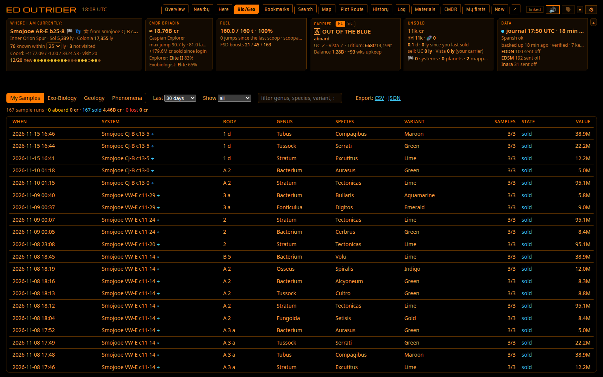
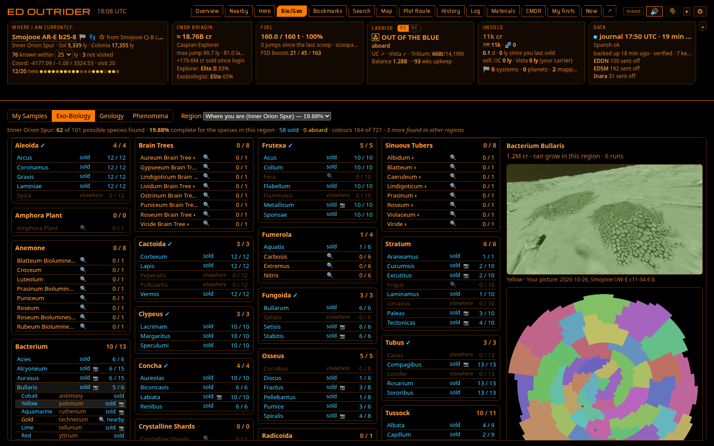

[ED Outrider](../../README.md) · [What's new](whats-new.md) · [Install and run](install.md) · [The views](views.md) · [Now](now.md) · **Exploring** · [Plot Route](plot-route.md) · [Cargo and trading](cargo-and-trading.md) · [Voice and alerts](voice-and-alerts.md) · [Automation](automation.md) · [On a tablet](tablet.md) · [In-game overlay](overlay.md) · [Uploads](uploads.md) · [Settings](settings.md) · [For the curious](for-developers.md)

# Exploring and exobiology

This page covers the Bio/Geo tab: your sample runs and the Exo-Biology, Geology and Phenomena checklists, with their
pictures. It then explains how Outrider guesses what grows on a body, the ✦ marks for types new to your codex, potential
green gas giants and exploring a boxel system by system.

## 🧬 Bio/Geo: My Samples

**Bio/Geo → My Samples** lists every exobiology sample run: species, variant, body, value, and whether it is *aboard*,
*sold* or *lost*. Filter, sort, export; codex entries are underneath.

- **Unsold runs** are priced one by one ("x5 on 42 of 47 runs").
- **A sold run** shows what Vista Genomics paid for it, with the estimate in its hover. A ≈ before an estimate means
  the sale was made before Outrider kept what each entry paid.
- **Beside it** are the [Exo-Biology](#-the-exobiology-checklist), [Geology and
  Phenomena](#-the-geology-and-phenomena-checklists) checklists.

## 🧬 The exobiology checklist

**Bio/Geo → Exo-Biology** shows every species the rules know, one box per genus, for a galactic region: where you are
(the default), any other, or **All regions**. Each species shows your best there, in colour:

- <b>sold</b> (green), <b>aboard</b> (amber: sampled, not sold yet), <b>lost</b> (red: sampled, lost with the ship),
  <b>logged</b> (blue: in your codex, no finished run);
- *elsewhere*: none here, but you have found it in another region (the line above the boxes counts them);
- greyed: not here, the rules say it cannot grow in this region. That is the rules' prediction, not proof that
  nobody has found it there;
- ◐: only in parts of the region (near Guardian sites, in tuber zones, by nebulae);
- a green **✓** beside a genus: complete there, every colour of every species that can grow in the region found;
- the colours you have found out of those it comes in (**3 / 12**). Anemones, brain trees and the like are their own
  one colour.

### A species' colours and map

Click a species to drop its colours down under it, each with what gives it ("Teal: M stars", or a material on the
body for some bacteria) and your state; click it again to fold them up.

The column beside the boxes shows its picture and a map of the galaxy with the regions it can grow in lit and your
samples as dots. Hover a lit region for its name and your completion there.

The line above the boxes counts it up: "Inner Orion Spur: 45 of 101 possible species found · 11.70% complete for the
species in this region · 43 sold · …".

  

### 🔍 Finding one nearby

**🔍** beside a species you have not found asks Spansh for the nearest bodies where commanders reported it. **🔍 nearby**,
beside a colour of it you have not found and in its column, does the same, in that colour when you picked one.

- **The list:** up to 25 bodies, nearest first, each with its distance, gravity, the colours reported there, and ✓ if
  you have been to the system.
- **On each row:** ☆ to bookmark it, **Copy** for the name to paste into the galaxy map and, where auto-target can
  work, **🎯** to target it there (see [Targeting and auto-target](plot-route.md#-targeting-and-auto-target)).
- **Its tick** adds the system to a sweep: one trip through every system ticked, from several species' lists too (see
  [A sweep](plot-route.md#-a-sweep)).
- It needs the internet, and lists only what commanders' uploads reported to Spansh.

### Completion

**Completion** counts what you have done, not only what is finished. Each species that can grow in the region scores
the share of its colours you have found there (sold, aboard, lost or logged), averaged over those species. So half of
every species is 50% with none complete. The region list shows each region's figure.

### Good to know

- **On the tablet:** its Bio/Geo page has it all too, with the species and a species' details scrolling separately.
- **Older journals:** journals from before a 2023 game update don't name a sample's colour, so those samples count the
  species but not a colour.
- **Colours unavailable:** the colour tables (which colours a species comes in, and what gives each) are downloaded on
  Outrider's first start. If that failed (offline at the time), the checklist's line, the body panel's Bio section and
  Here's footer say "colours unavailable: tables not downloaded · **Retry**", and a card at the top of the page has
  Retry too. It downloads only those tables, and the colours show at once.

## 🪨 The Geology and Phenomena checklists

Beside Exo-Biology, two more checklists on the Bio/Geo tab work the same way for the rest of the codex.

### Geology

**Bio/Geo → Geology** is the same for the codex's surface geology: fumaroles, gas vents, geysers and lava spouts.

- **Each entry** is logged in your codex for the region, or not.
- **Beside it:** how many sites players have reported in that region (from [Canonn](https://canonn.science)), greyed
  where none have been reported yet. That is not to say there are none.
- **Completion** is the share of the entries reported in the region that you have logged.
- **Click one** for its picture, its sites in the galaxy, where you logged it, and the map of the regions it has been
  reported in.
- **🔍** on an entry you have not logged lists the nearest bodies where commanders' mapping reported it to Spansh, as
  for a species (☆, Copy, 🎯).

### Phenomena

**Bio/Geo → Phenomena** is the same for what is found in space at notable stellar phenomena: Lagrange and storm clouds,
ice, silicate and metallic crystals, mineral spheres, calcite plates, the space organisms (molluscs, pods, trees...)
and the lettered anomalies.

- **Grouped by where you find them,** so the anomalies and clouds the game's codex files under Geology and Anomalies
  are here. An entry's panel names the codex section it is in.
- **🔍 nearby** lists the nearest systems where it has been reported, from Canonn's list for that entry. It is fetched
  when you ask; nothing about you is sent.
- **Your shots:** with your codex folders on (⚙ Settings → Screenshots), a shot you take at a phenomenon is filed under
  the codex entry you logged there, in `Phenomena/<group>/<entry>/`.

## 🖼 The checklists' pictures

The checklists show a picture of each entry that has one: Canonn's, or one of your own when you have one.

### Canonn's pictures

- **Linked, not copied:** the pictures are [Canonn](https://canonn.science)'s screenshots, each credited to the
  commander who took it. Outrider links to them and keeps no copy: they load from Canonn when you open an entry. Click
  one for full size.
- **Colours:** click a colour under a species for that colour's picture.
- **Missing ones:** a few entries have none yet. Outrider asks Canonn for its latest list once a day, so new pictures
  appear as they are added.

### Your own pictures

With **⚙ Settings → Screenshots → Show your own pictures on the Bio/Geo checklists** ticked, a picture of your own
from your codex folders shows instead wherever you have one, picked at random. How shots reach those folders is under
[Screenshots](automation.md#-screenshots).

- **Which picture:** one at random from its codex folder each time you open the entry. Canonn's still shows where the
  folder is missing or has none.
- **Any picture counts** (PNG, JPG, WebP, GIF), so crop or edit the copies, or add your own.
- **Clicks:** a click on a colour you have several pictures of picks another; a click on the picture opens it full size.
- **The caption** under it says when and where you took it ("Amethyst · Your picture: 2026-10-26, Smojooe UW-E c11-34
  6 b"), as far as the picture itself says (Outrider writes it in; an editor may drop it), else "Your picture, from
  your codex folders".
- **📷** beside an entry, and beside each colour of an open species, says you have pictures of your own of it.
- **A picture that does not open** in the folder (empty, not a picture) is passed over, and Canonn's shows if none does.

## 🌿 How the exobiology guesses work

Before a body's plants are sampled, Outrider guesses which species can grow there. Those guesses are possibilities,
not promises. Where they show, and how a finished species looks, is under [Here](views.md#-here).

- **Where they come from:** each species' known spawn conditions, as maintained by the
  [BioScan](https://github.com/Silarn/EDMC-BioScan) project, including its check on which star types a species appears
  around. Each start checks GitHub for newer rules.
- **What they mean:** until every body is found, nothing is ruled out on what isn't known yet. The genus is usually
  right, the species sometimes not, so values show as "up to".
- **✦ and ✪:** the ✦ "new to your codex" mark checks the colour variant when it can be told, and names it ("✦ Grey").
  ✪ is a species or colour in your codex nowhere at all ("✪ Cobalt"), worth more effort.
- **Bacteria:** a Bacterium's colour comes from a rare element in each body's own materials, so bodies in one system
  can differ.
- **Showing less:** ⚙ Settings → Display can leave out of Here's bio column the species you have finished and the
  bodies with few signals, and show each species' colour word in that colour ("Red" in red; this device).

## ✦ Star and planet types and geology new to your codex

The codex logs every star and planet type once per region, the first time you scan one there (a K-type giant, a
terraformable water world, a rocky body with an atmosphere...). Outrider knows which entry each body would log and
which your codex has.

Your codex, for this, is the codex lines in your journals and every type you have scanned yourself in a region. The
game logs a type the first time, so one you scanned without a line was logged before your journals begin. A nav
beacon's data does not count.

### Stars and planets

- **✦** beside a body in [Here](views.md#-here): its type is not in your codex for this region; **✪**: in your codex
  nowhere. The tooltip names the type ("K-type giant: new to your codex in this region").
- **On a [Nearby](views.md#-overview-and-nearby) row**, one tag for the system ("✦2"), each type and its bodies in the
  tooltip. Spansh's bodies count too, so a system can be picked for it before you go.

### Geology

- **The mark:** a landable body with geological signals and volcanism gets **✦** (✪: anywhere) when its volcanism
  could show a geological feature not in your codex for the region.
- **The tooltip names the new ones,** since one volcanism can show one of a few features. Rocky magma, for one, can
  show a sulphur dioxide fumarole or gas vent, a silicate magma lava spout, and now and then a silicate vapour gas
  vent. The approach card says them too.
- **Every kind:** the body's hover card and its details panel (a 🪨 section) list every kind its volcanism allows, the
  new ones marked ✪ or ✦.
- **Your codex's geology** is its lines in your journals (a scan logs none). Combinations never seen on EDDN (water or
  CO2 features on a rocky body, anything on a rocky ice body) get no mark.

### Good to know

- **Said as well as shown:** these marks are shown only, but what a body's signals could log (its species and its
  geology) is also said as the FSS finds them: ⚙ Settings → Voice → What the voice says → possible new codex entries
  (see [The voice](voice-and-alerts.md#-what-it-says)).
- **No mark:** a type the journals give no codex entry for (a class II giant star, a helium gas giant) gets no mark,
  nor does a body Spansh lists without its luminosity or atmosphere.
- **Nothing to compare with:** with no body type in your journals at all (no codex line, no scan of your own), nothing
  is marked.

## 🟢 Potential green gas giants

A green gas giant looks like any other in the FSS: nothing flags it. The community's **seven-layer ladder** model
(CMDR Regza's, from a hint by Dr. K. Ross and CMDR Arcanic, whose edGGG catalogue it was fitted to) predicts which ones
render green from a giant's surface temperature, mass and radius. Outrider runs it on every gas giant it has the
journal's own figures for: your scans, and Spansh's records of other people's.

- **A green planet with "?"** marks a potential one. It shows beside the body in [Here](views.md#-here), on the
  system's row in [Nearby](views.md#-overview-and-nearby) (a system worth going to), and as a Now line ("Potential
  green gas giant: B 3 · check in the system map").
- **"Check in the system map"** means the game's own system map, where its real colour shows. Outrider's 🪐 map
  ([the system map](now.md#-the-system-map)) draws a giant by its class and cannot tell.
- **Without the "?"** it is confirmed: your codex has its green entry. The game files it on the system's main star,
  not the giant, but writes it in the same second as your FSS scan of the giant, which names it.
  - Only when no scan of yours shares that second (an older journal, say) is the giant picked by its class: the only
    one of that class, else the ones the model flags, else all of them.
  - Then the hover says "one of these 2", and Now, the 📋 summary and the overlay say "one of".
- **"Potential green gas giant"** is said when one of your own scans fits (its own switch under Discoveries: see
  [Alerts](voice-and-alerts.md#-alerts)).
- **"likely" and "possible":** "likely" is a confirmed rule of the model, "possible" a derived one. It is a guess about
  where to look: some kinds (Class II, V, helium giants) and some temperatures cannot be predicted at all, and nothing
  is said for them.

### Finding one

- **[Search](views.md#-search)'s *Potential green gas giant*** (under Planets) runs the model over every giant in
  reach: *Local* over what Outrider has cached, *Spansh* over every giant Spansh knows of the kinds it can judge.
- **By voice** (the Android app): "nearest green gas giant" (Outrider's cache, within 500 ly; see [Ask Outrider by
  voice](voice-and-alerts.md#-ask-outrider-by-voice)).
- **Expect few:** the model calls very few giants green.

## 📦 Boxel exploration

A procedural system name says which cube of space (a **boxel**) it is in and what kind of stars that cube makes: in
`Drojau TF-H c13-5` the **c** is the mass code (a 40 ly cube of K and M stars, some G) and **5** the system's number.
A boxel's systems are numbered 0, 1, 2… without gaps, so you can visit them in order.

### The Boxel list

**Nearby → Boxel** lists the boxel you are in by number. The switch is on the Overview's bar, and on Nearby's top bar
on the Nearby tab; one choice for both.

- **Each system:** ones you visited show your scans as Nearby does, ones Spansh knows are marked "known" (someone has
  been there), the rest are "to try".
- **Above the list:** how many you have visited, how many Spansh knows and the **highest known** number (yours or
  Spansh's).
- **On the game PC,** **Next** (with 🎯 where auto-target can work) is the lowest number you have not visited, and
  every row has its own 🎯.
- **A row's 🎯:** auto-target types the name into the galaxy map and checks the game targeted it, even for a system
  nobody has visited. Outrider works out its address from the boxel. See [Targeting and
  auto-target](plot-route.md#-targeting-and-auto-target).

  

### The end of a boxel

- **⚠ Outrider cannot know how many systems a boxel holds.** It offers a few numbers above the highest known; explore
  until a name the galaxy map cannot find. When auto-target cannot find one above every known number, the list says
  "probably the end" (**retry** if it was only a hiccup).
- **✓ complete** shows by itself once the end is known and you have visited every system below it (**✓ empty** when
  the galaxy map found none of its names). The boxel is then marked done by itself.
  - A **retry** above the end takes that back, and keeps the boxel again if it was kept. So does a name found above
    the end: it was not complete after all.
  - Picking a complete boxel keeps it, marked done.
- **✓ Done with this boxel** is your call, complete or not. **undo done** reopens it, and a reopened boxel is never
  marked done by itself again until you press Done.
- **Once done or complete,** either way: Next offers nothing more, and the boxel leaves the recommendations (the next
  nearest of its kind takes its place; "done or complete nearby" lists them). It is dimmed on the sector map, and a
  kept boxel is let go.

### Known systems, keeping and auto-target

- **How much anyone reported:** a system Spansh knows says so, "known · 3 of 14 bodies", "known · honked only",
  "known · all 38 bodies".
- **Skip systems already fully scanned** (opt-in): Next and the auto-target pass over the ones with every body
  reported. One only passed through or partly scanned still has first discoveries to find.
- **📌 Keep this boxel** stays on it when you jump out.
- **Auto-target the next on arrival** (opt-in) targets the kept boxel's next system each time you arrive in one of its
  systems.

### Boxels nearby and the sector map

- **Boxels nearby** lists the nearest boxels of each mass code in sectors you have been to, with each one's highest
  known number, what each kind tends to hold, and your own figures for it ("from your 852 d systems: 41% with
  biology…"). **Explore this boxel** keeps one.
- **Sector map** draws the sector you are in as a grid of one mass code's boxels (b to h: a's 128 × 128 a layer is
  too many), one Y layer at a time.
  - **Layers:** yours first, ▲ ▼ for the others, the layers holding your visits listed beside them.
  - **What it shows:** visited (with how many, on the coarser grids), ✓ complete, done, Spansh knows, you outlined,
    the kept boxel framed.
  - **Directions:** +Z (toward the core) is up and +X right, as on the galaxy map. A tap explores that boxel.

  

### Good to know

- **Hand-made sectors** ("Col 285 Sector…") lay their boxels out differently: their list works, without 🎯 (Outrider
  cannot work out their systems' addresses).

---
[ED Outrider](../../README.md) · [What's new](whats-new.md) · [Install and run](install.md) · [The views](views.md) · [Now](now.md) · **Exploring** · [Plot Route](plot-route.md) · [Cargo and trading](cargo-and-trading.md) · [Voice and alerts](voice-and-alerts.md) · [Automation](automation.md) · [On a tablet](tablet.md) · [In-game overlay](overlay.md) · [Uploads](uploads.md) · [Settings](settings.md) · [For the curious](for-developers.md)
