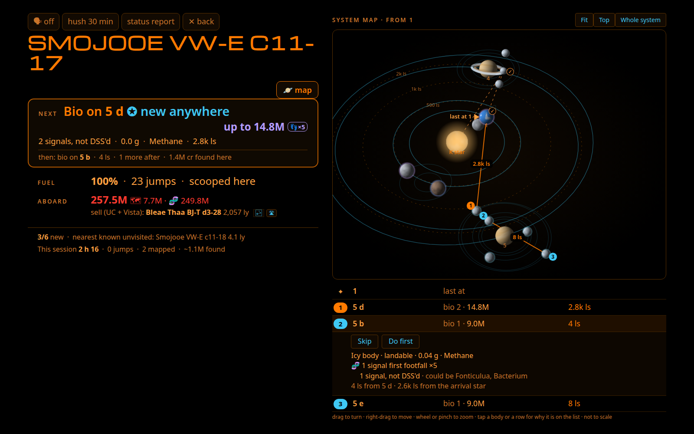
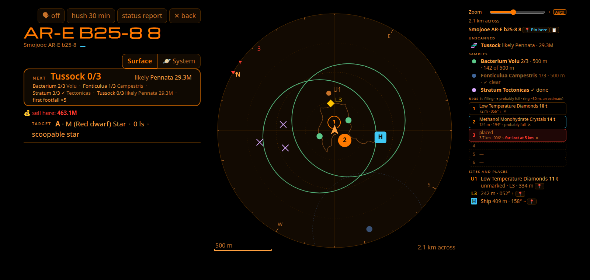

[ED Outrider](../../README.md) · [What's new](whats-new.md) · [Install and run](install.md) · [The views](views.md) · **Now** · [Exploring](exploration.md) · [Plot Route](plot-route.md) · [Cargo and trading](cargo-and-trading.md) · [Voice and alerts](voice-and-alerts.md) · [Automation](automation.md) · [On a tablet](tablet.md) · [In-game overlay](overlay.md) · [Uploads](uploads.md) · [Settings](settings.md) · [For the curious](for-developers.md)

# Now

**Now** is the cockpit view for a second monitor or a tablet, in big text, laid out so it reads at a glance. Each part
has a fixed place, and a value never breaks in the middle: a line wraps only between its facts. **↗** beside the Now
button, or `?mode=now`, opens it on its own ([In its own window](#in-its-own-window)); on a tablet, see
[On a tablet](tablet.md).

## 🖥 Now, top to bottom

1. **The system's name.** On a planet, the body's name instead, except docked at a planetary port ([Now on a
   planet](#now-on-a-planet)).
2. **The headline card:** one thing at a time, the most important first: the pad you were given, a refusal, whether
   the system was undiscovered, else **Next** ([The headline card](#the-headline-card)).
3. **A passing alert**, for fifteen seconds, in its own small card under the headline ([Alerts](voice-and-alerts.md#-alerts)).
4. **Target:** the body you have targeted when it is not Next, on one line ("1 d · Rocky body · 0.13 g · Ammonia ·
   902 ls · 4 bio, under your threshold"), its likely genera and their values smaller under it.
5. **The status rows,** each label in a column on the left and its value in the same place every time, a row only
   when it has something: **Fuel**, **Aboard**, **Jump** (the system targeted for the next jump), **Route**, **Boxel**,
   **Sight**, **Mining** and **Here** (this system's finds as a row of chips). Each is described below.
6. **The foot,** small: the streak, this session and the captions ([The foot](#the-foot)).

### The headline card

The card under the name shows one thing at a time, the most important first.

- **Docking:** from a docking grant until you touch down, **PAD 34** in very large letters, and where it is. At a
  starport or carrier, its diagram too. A carrier's name follows the galaxy map's fleet or squadron carrier marker.
- **Refused:** a refusal's reason, for a minute.
- **After a jump:** for twenty seconds, whether the system was undiscovered.
- **Next:** otherwise, what to do here: "Bio on 1 e" with "up to 64.6M 👣×5" on the right, "Map 3 a", "Honk",
  "3 bodies to find in the FSS", "✓ nothing worth staying for". Its facts are under it: signals, gravity, atmosphere,
  how far it is ("≈" when about).
- **then:** the stop after it in the suggested order ("then: map 3 a · 1.2k ls · 2 more after"). After the last stop
  it says "then: honk" or "then: 5 bodies to find in the FSS" while the system still has them, else "then: nothing
  else worth the trip".
- **What you found here** is on the card too.

### Fuel

- **Scoopable stars:** under fuel, "scoopable: 9 of last 20" (amber as on the fuel tile).
- **Last scoop:** at the last scoopable star before a dry stretch, "⛽ last scoop before 3 dry", with how much to
  scoop.
- **While you scoop,** the fuel row counts down to a full tank ("38 s to full"). It goes by the rate it is filling
  now, so it slows at the edge of the scoop zone.

### Jump

The system targeted for the next jump.

- **How much is known:** "3/12 known" (Spansh's bodies of its count) and what EDSM has ("EDSM 5/12", or "not
  logged"). They are two databases with different reporters.
- **The hover** says who first reported one of its bodies to EDSM, and when. That is EDSM's own record, not the
  game's discovery tag. [Here](views.md#-here)'s heading keeps "EDSM: since 2016" once you are there.
- **A new target:** while it is looked up the row says "checking…", never the previous target's verdict.
- **The cost,** under it: "56.7 ly · 0.9 t · leaves 20 max jumps".

### Route and Boxel

Where the next jump goes. Each shows 🎯 where [auto-target](plot-route.md#-targeting-and-auto-target) can work.

- **Route:** the route's next stop as the strip under the header says it ("🛣 Next: Stop 38 · 4.2 ly · 38 of 120 ·
  refuel in 3 jumps", or the Road to Riches / Exomastery one). See
  [The route lines](views.md#-the-route-lines-and-the-plotted-route-pane).
- **Boxel:** a kept boxel's Next, or the boxel followed in Boxel mode: "next Smojooe KL-P d5-41 · to try" or "·
  known · 3 of 14 bodies". See [Boxel exploration](exploration.md#-boxel-exploration).

### Sight

The nearest catalogued sight: "Nearest sight: 📜 The Ammonia Lyceum · Athaip WR-H d11-7577 · 320 ly", with 🎯.

- **Where from:** [EDAstro's Galactic Encyclopedia Catalog](https://edastro.com/gec/), the community's curated
  sights (scenery, planetary and stellar features, green gas giants, nebulae...). Its page opens from the name.
- **How far:** within 500 ly (`[server] sights_range`). 0 turns it off, and nothing is fetched.
- **Elsewhere:** Here's heading names the sights of a system that has one, and Nearby's row has 📜.
- **The catalogue** is asked for once a day (stored again only when it changed) and never shipped.

### Aboard

What is aboard against your rebuy: "792M 🗺 380M · 🧬 412M · 3.2× rebuy · 4 d unsold", with "sell (UC + Vista): Far
Sys 412 ly" under it. The row shows only once that is over your amber level or rebuy multiple.

- **Where to sell:** the nearest station (or your own carrier, or your squadron's) for whichever of the two holds most,
  with a large pad when your ship needs one. Another player's carrier is never named: it may have moved or be closed.
- **🎯** targets it, and from 250 ly **🛣** plots an exact route there at once (asking first when you follow a route).
- **Docked** where your data sells, it says what selling here pays ("💰 sell here: 380M").
- **On a high-g approach** it shows that approach's stakes instead.
- **A ship bought with Arx** (its hull has no credit value) gets no rebuy multiple.

### Mining

While mining in a ring (a mining ship, in normal space): ⛏ with the ring and hotspot, tons an hour, the hold and what
it holds most, limpets, minutes to full and this stint's hits.

- **Limpets:** under 10, how many more your materials could make: "limpets 4 (+12 by synthesis)".
- **Hits:** with minerals ticked for the call-out, this stint's hits ("hits 3/8").
- **Warnings:** [Voice and alerts](voice-and-alerts.md#-alerts) has them.

### Here

This system's finds, as a row of chips:

- **Signals worth a detour:** "Titan Cocijo · 📍 2 tourist beacons". A Titan's name follows the galaxy map's Titan
  marker.
- **Surface sites:** "🏛 Guardian sites on 10 b".
- **[Green gas giants](exploration.md#-potential-green-gas-giants).**
- **A rare star:** "⭐ A black hole (main star)".
- **The notable stellar phenomena:** "🌀 Three notable stellar phenomena, all in rings · 1 of 3 visited". Each drop at
  one counts, since the journal cannot tell which of a kind's sites it was.
  - Then what Canonn's reports name there: "reported: ✓ Albulum Gourd Mollusc, Prasinum Metallic Crystals (new)".
    ✓ is one you logged in the system, (new) one new to your codex in the region.
  - Before the FSS lists any, "🌀 Reported by Canonn: …" alone.
  - Canonn is asked once as you arrive, with the system's name only. `[server] canonn_reports = false` stops it.
- **Spansh's pre-Odyssey data.**

### The foot

Small, at the bottom: your discovery streak and the nearest unvisited system, this session, the captions and (on a
tablet over plain http) the screen-sleep hint.

- **This session** since your login: "2 h 14 · 74 jumps · 612 ly · 6 new systems · 11 mapped · 4 samples · ~38.0M
  found" (the unsold estimate's change plus what you sold). After you quit, the last session.
- **Captions** show the last three lines said, newest first, as many as fit the height left under the rows (the
  newest always). Tap one to hear it again. A corner bar has 🗣, hush 30 min, status report and ✕ back.

### In its own window

- **↗** beside the Now button opens Now in its own window. Or open `http://127.0.0.1:8025/?mode=now`, which stays on
  Now even after a stray click or a reload.
- **The screen:** Now keeps the screen awake on localhost or HTTPS. On a tablet over plain http, set its screen
  timeout.

### Now on a planet

On a planet, the [surface map](#-the-surface-map) appears and Now makes room for it.

- **The title** is the body ("ZC-D c12-22 8"), with the system small beside it and how you are there: "in the Rhino",
  "on foot", "landed", "flying low".
- **Next** is the job on this body:
  - the sample run under way: "Bacterium Volu 2/3 · 142 of 500 m from the nearest sample · keep going" or "✓ clear to
    sample";
  - else the next genus not started, or one whose samples died with your ship ("Bacterium lost ✗ · sample again");
  - the pin you fly to;
  - or "✓ nothing left on this body", with where your ship is.
- **Only warnings stay:** the data aboard at your amber level (or a high-g approach's stakes) and low fuel, each on one
  line; a sample run on another body; the wrong suit; another body of this system targeted; and the newest caption.
- **Leaving the body** brings back Route, Boxel, Here, the streak and the session.
- **At a planetary port:** docked there (or on foot inside it), Now keeps the system's layout, with no map.

## 🪐 The system map

**🪐 The system map**, beside Now's title, draws the system you are in in 3D, with the suggested order on it. Beside it
(or under it) the stops are listed.

### What it draws

- **The bodies:** each body you have scanned, where it is on its orbit now, drawn as in [Here](views.md#-here)'s
  schematic (class colours, bands, atmosphere, rings), with its orbit.
- **The order:** a line from where you are (the body you were last at, else the arrival star) through the stops. Each
  stop is numbered, two numbers on a body with both mapping and bio. Each leg has its distance ("1.5k ls", "≈" when
  about). A stop not worth the trip is dashed.
- **Where you have been** this visit: a grey broken line from the arrival star through each body you were at
  (approached, landed, dropped at or mapped), each with a grey ✓. The list leaves those out, starting at the body you
  were last at.
- **Not to scale:** each family (a star's planets, a planet's moons) is squashed on its own log scale. So a moon a few
  light seconds from its planet stays clear of it, and a far star stays on the screen. The faint rings round the star
  (1k, 2k ls...) give a sense of size.

### The list

One line per stop: the body, why it is there and what it pays ("map 1.9M", "bio 3 · 19.3M"), and its leg.

- **Not worth the trip:** the stop is dimmed, its number dashed.
- **The body's class and both map totals** are in its card (hover it) and its drop-down (tap it).
- **With no stop yet** the list says why: **honk first** before the honk, **3 bodies to find in the FSS** while the FSS
  has some left, **nothing worth the trip here** once every body is found and none is over your levels.
- **No orbit:** a stop whose scan gave it no orbit is named under the list ("not on the map (no orbit in the scan):
  2 a"). It keeps its place in the order but has no number on the map.

  

### Using it

- **Moving it:** drag to turn, right-drag to move, the wheel to zoom. On a tablet, one finger turns, two move and
  pinch.
- **Fit** frames the order, where you are and where you have been: as it opens, and again at each new system, until
  you move it. **Top** looks straight down. **Whole system** frames every body.
- **Tap a stop** (a row of the list, its number or the body on the map) for why it is on the list, under its row: the
  body's class, its mapping value now and with your bonuses, each genus with its likely species and value (and with
  the ×5 first footfall when it still pays it), what is sampled or lost, its gravity and air, and its leg. Tap it
  again, or another, to close it.
- **Skip,** at the top, leaves it out of the order everywhere until you leave the system: Next, the "then:" line, the
  map, Here's schematic, the overlay. Here's to-do line names it under "skipped:". The **skipped:** line under the
  list puts one back, and **↺ order** puts back all of them.
- **Do first,** beside it, makes it the first stop.
- **Hover or tap any other body** for its card: its class and how far it is from where you are.
- **On the PC** the 🪐 map button opens it beside Now's text, and it stays on in that browser until you turn it off.
  In a window too narrow for both (under 1200 px) it is **Text | 🪐 Map** instead: the map in place of the text, with
  the headline card above it on one line.
- **On a body** the surface map comes first. Now's switch then reads **Surface | 🪐 System**, and System shows the
  system map for that body until you take off or move to another body.
- **Before the FSS** there is nothing to draw ("scan the system to see its bodies"): every body's orbit comes from
  your own scans.

## 🗺 The surface map

On a planet, Now shows a map under its lines (beside them on a wide landscape screen): your ship, samples, tagged
plants, rigs, pins and sites around you, turning with you.

  

### When it shows

- **On Now:** on the ground, in the SRV, on foot, or flying below 1,000 m. It hides again 100 m higher. Hiding deletes
  nothing.
- **In the Overview:** the same map, in the lower half of its system pane. A body panel you open takes its place until
  you close it. The body you are on is brought to the top of the list above it, and the firsts and the checklist under
  the system's name give it their room.
- **On the other tabs:** a small one.

### Your trail

A faint line under the markers is **your trail** on this body this visit: driving, walking or flying low, below
1,000 m. It is the ground you have already looked over while you hunt for the last species.

- **Orbital cruise:** a pass in orbital cruise is not part of it, and leaves a gap rather than a line across it.
- **A fresh start:** it starts afresh on another body, or when you leave this one's orbit or restart Outrider.

### Heading, compass and zoom

- **Heading-up:** the way you face is the top, you are the arrow in the middle, N on the rim is north. It zooms to fit
  everything within 3 km, never narrower than 500 m, with a scale bar.
- **The compass grid** turns with you: ticks on the rim every 15° (longest at N, E, S and W, with their letters), a
  crosshair along your heading and quarter rings, to read a bearing at a glance.
- **Zoom:** the slider on top of the legend zooms by hand, from 100 m across (right) out to everything on this body
  (left: every site, rig, sample, pin and the path you have flown and walked here, plus 10 km; at most 500 km). It
  switches **Auto** off; the map then stays at that zoom, showing whatever fits in it (past the 3 km too).
- **Auto,** beside it, fits everything near you again. Pressing it off keeps the zoom Auto had. The figure after it
  is how much ground the map shows.
- **Remembered:** this device remembers the zoom, for Now's map, the Overview's and the small one on the other tabs.

### What is drawn

- **Your ship:** a landing-pad H.
- **Samples** of unfinished bio runs, with each species' colony ring. The current run is solid.
- **Each species you finished on this body:** its three samples where you took them, as small × in its colour, and
  "✓ done" in the legend. Each species keeps one colour on the body throughout.
- **Plants you tagged** ([below](#tagged-plants)).
- **Your rigs** 1–6, with a faint spacing ring ([Rigs in the Rhino](#-rigs-in-the-rhino)).
- **Saved sites** (U1… unmarked, S1… rigs picked up) and **mining locations** (L3).
- **Off the map:** anything off it is a chevron on the rim.

### Unscanned

At the top of the legend, the biology on this body you have not sampled yet.

- **Each genus the DSS found** that you have not started, with its likely species and value ("Stratum · likely
  Tectonicas · 19.0M").
- **Lost:** one whose samples were lost with the ship ("lost ✗ · sample again").
- **Before the DSS:** how many signals there are and what they could be.
- **Leaving the list:** each leaves it once you have identified it: tagged with the composition scanner (it moves to
  Tagged; before the DSS a tag accounts for one of the signals) or sampled (it moves to Samples). The heading goes when
  nothing is left.
- **Geology is not listed:** the DSS writes only how many geological signals a body has, never which features.

### Tagged plants

As BioScan's waypoints: point the composition scanner at a plant, from the ship flying low, the SRV or on foot, and
Outrider remembers where it is, as a hollow ring in the species' colour.

- **Faint** means a sample there would not count: it is inside the colony of one you took.
- **While sampling,** the strip says the nearest one that would count and which way to turn ("tagged: 524 m, turn 90°
  right"), and the voice says so within 100 m.
- **From the ship or SRV** the scanner logs no position, so it is yours at that moment: scan as close to the plant as
  you can.
- **A finished species** drops its tags on the body.

### The legend

The legend names each tag, nearest first, in sections: Samples, Tagged, Rigs, Pins, Sites and places. Each row has its
mark in a column on the left (the species' colour, U1, L3, H) and its details muted beside it.

- **Species:** each sampled and tagged species is named as Here does, with its colour as the game names it, and 📷 when
  your codex folders have a picture of it. On a PC, a mouse over the name shows a picture of it: one of your own at
  random, else Canonn's.
- **Rig slots:** six, mirroring the game's HUD: mineral (or "placed"), tons so far, distance and bearing.
- **Probably full:** a solid rig is **probably full**: 8 minutes since it was placed or last collected from.

### The map's settings

In ⚙ Settings → Surface map:

- **The map's sizes,** each browser's own.
- **Strip copy:** a tick adds a small copy to the on-body strip, with a one-line legend.
- **The leash distance** and **pickup pins:** see [The leash](#the-leash) and
  [Pins at Guardian and Thargoid sites](#pins-at-guardian-and-thargoid-sites).

## 📍 Pins

Named points on a body, kept until you delete them: the Anaconda wreck, Guardian ruins, a good spot to come back to.

### Adding one

- **By its coordinates:** open the body's panel (Here or Overview), its **📍 Pins** section, and paste or type the
  coordinates: `-12.34, 45.67`, `Lat -12.34 Lon 45.67`, `12.34 S, 45.67 E`, `N 12.34 W 45.67`; text around them is
  fine. It shows what it read before you add it.
- **Before you reach the body:** that works too, from a Canonn page while still in supercruise.
- **Where you are:** on a body, **📍 Pin here** (by the map's legend title) pins where you are, and **📋** copies your
  coordinates to share.
- **From the legend:** **📍** beside a site, a mining location or the ship pins it and takes you there.
- **Where a screenshot was taken:** see [Screenshots](automation.md#-screenshots).

### Known sites

On a landable body with Guardian or geological signals, the 📍 Pins section also lists what other commanders reported
to [Canonn](https://canonn.science) with a position.

- **What is listed:** Guardian ruins and structures ("Guardian ruins 2", "Guardian structure (small)") and each
  geological formation ("Silicate Vapour Fumarole · 5 reported"), each with **📍 pin it**.
- **A formation** pins its reported spot nearest you when you are on that body, else the first one reported.
- **Pinned:** one you have pinned shows ✓, and the section's heading counts the rest ("📍 Pins · 1 · 2 known sites").
- **Asking:** Canonn is asked only for such a body, and its answer is kept a day.
- **No live source:** wrecks, crash sites and Thargoid sites have none. Pin those where you stand or by their
  coordinates.

### Flying to one

- **The target:** one pin at a time: the one you tapped (in the legend or the panel), else the first not reached, in
  their order (▲ ▼ in the panel).
- **The way:** from orbital cruise down, the strip and Now say how far and which way ("📍 Wreck: 12.4 km, turn 30°
  right"). The map draws it (on the rim when it is off the map), and the [overlay](overlay.md)'s radar shows it with a
  line.
- **The Navigator** says it when it is set ("Wreck set. 340 kilometres, bearing 120."), at 10 km, 1 km and 100 m, and on
  arrival, then the next pin's way. The status report starts with it.
- **Arrival** is within 50 m on foot or in the SRV, 250 m in the ship, counted through the air: flying over a pin high
  up is no arrival.
- **Reached pins** are dimmed, with ↺ to undo.

### Finding them again

A 📍 beside a body with pins in Here and Overview, and every pin in **Bookmarks** (with Plot route to its system).

### Pins at Guardian and Thargoid sites

Picking something up at one drops a pin where you stand: "Guardian site (pickup)" or "Thargoid site (pickup)".

- **What counts:** a Guardian relic, orb, casket, tablet, totem or urn, a Guardian material or obelisk data; a Thargoid
  Sensor, Probe or Link, Thargoid materials such as a Sensor Fragment, Meta-Alloys.
- **Where:** on foot, in the SRV, landed or hovering low; never in space.
- **One per site:** another pickup within 2 km adds to it ("Guardian site (pickup) ×3").
- **Reached already:** it is made reached (you are there), so nothing is said. ↺ makes it the target for a later
  visit, and you can rename or delete it like any pin.
- **Only while playing:** only what you pick up while playing counts; re-reading your journals makes none.
- **Turning it off:** a tick in ⚙ Settings → Surface map.

## ⛏ Rigs in the Rhino

The game logs nothing when you deploy or pick up a rig, so you tell Outrider with the
[co-pilot button](automation.md#-the-co-pilot-button).

### Marking rigs

In the Rhino on a planet:

- **Tap away from your rigs:** the next rig (lowest free number, 1–6) is placed 7 m behind you, where the game drops
  it. "Rig 3 placed."
- **Tap within 5 m of a rig:** it is picked up and its number is free again.
- **Nothing else:** the button does nothing else in the Rhino. Anywhere else it works as usual. Getting out on foot and
  back in keeps it marking rigs.
- **Forgot to tap?** The ✕ by a rig's slot in [the legend](#the-legend) marks it picked up.
- **Rigs still out:** docking the Rhino with rigs still marked out on the body says so, and a card shows it ("Rigs 2
  and 5 still marked out; rig 5 is probably full."). It is Outrider's record, not the game's, so a rig picked up
  without a tap counts until you ✕ it.

### Automatic and not automatic

- **Automatic:** collections (the tons go to the rig under you, or an unmarked site, and are said once you stop: "Rig
  3: 12 tons of Water."), your ship's landing spot, mining locations you targeted from the ship, and rigs lost at
  5 km, on leaving the body, or with the Rhino destroyed, a death or a relog.
- **Not automatic:** placing and picking up rigs, and what a deposit holds.
- **Saved sites:** a rig that collected anything is kept as a saved site for your next visit and listed under
  Materials' **Mining sites**.

### The leash

The game destroys a rig 5 km from its Rhino.

- **The warning:** past 3.5 km it turns red and the voice warns, again at 4.5 km ("Rig 3 is 3.8 kilometres away,
  behind you; it is lost at 5.": which way, in eight sectors).
- **The setting:** the leash distance ("a rig far away at") is in ⚙ Settings → Surface map. It is one value for every
  window and the spoken warning: it is saved in the config file (`[defaults] rig_warn`) and used at once.

---
[ED Outrider](../../README.md) · [What's new](whats-new.md) · [Install and run](install.md) · [The views](views.md) · **Now** · [Exploring](exploration.md) · [Plot Route](plot-route.md) · [Cargo and trading](cargo-and-trading.md) · [Voice and alerts](voice-and-alerts.md) · [Automation](automation.md) · [On a tablet](tablet.md) · [In-game overlay](overlay.md) · [Uploads](uploads.md) · [Settings](settings.md) · [For the curious](for-developers.md)
