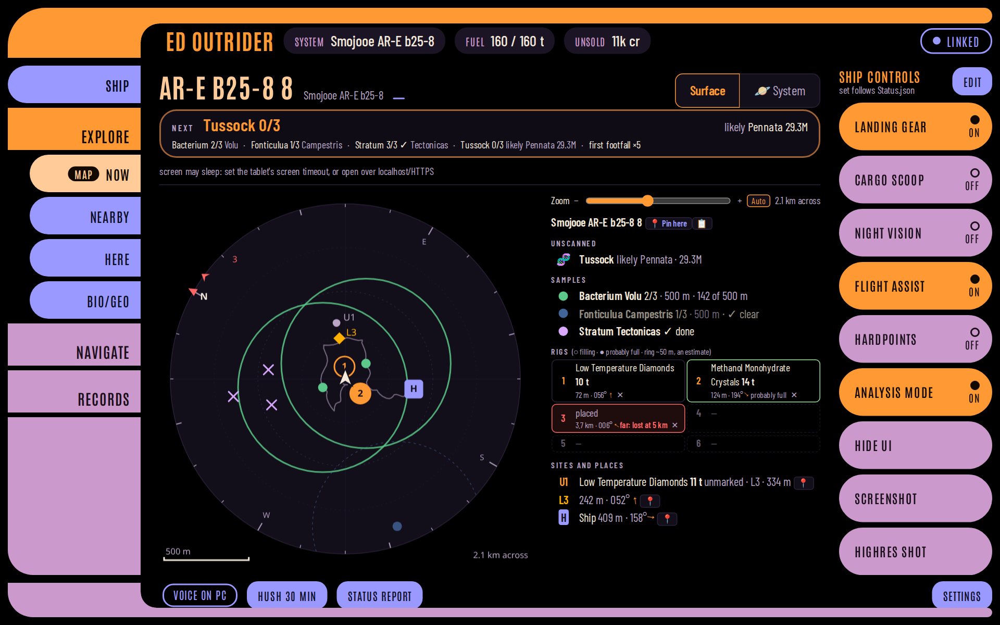

[ED Outrider](../../README.md) · [What's new](whats-new.md) · [Install and run](install.md) · [The views](views.md) · [Now](now.md) · [Exploring](exploration.md) · [Plot Route](plot-route.md) · [Cargo and trading](cargo-and-trading.md) · [Voice and alerts](voice-and-alerts.md) · [Automation](automation.md) · **On a tablet** · [In-game overlay](overlay.md) · [Uploads](uploads.md) · [Settings](settings.md) · [For the curious](for-developers.md)

# On a tablet

Open `http://<your PC>:8025/tablet` on a tablet in landscape. It is made for a larger tablet, about 1280 × 800 CSS
pixels. You get the same pages in a cockpit layout, in one of [eleven themes](#-settings-and-themes).

  

## 🔌 Getting it onto the tablet

Outrider must listen on your network for this: see
[Other devices on your network](install.md#-other-devices-on-your-network).

- **The address:** ⚙ Settings → Server, under `[server] host`, gives the address to open
  (`http://192.168.1.23:8025/tablet`, with Copy), or what to change first.
- **On Windows,** allow Python through the firewall on **private** networks when it asks. That section says how if
  Cancel was clicked.

## 🧭 The layout and pages

- **The strip on top** shows the system, fuel and unsold data, and the link to Outrider in words ("LINKED",
  "LINKED · NO GAME", "UNLINKED · RETRYING").
- **The pages** are on the left in three groups: Explore (Now, Nearby, Here, Bio/Geo), Navigate (Bookmarks,
  Search, Map, Plot Route) and Records (History, Log, Materials, CMDR, My firsts). There is no Overview.
  [Ship](#-the-ship-page) sits at the top of the list.
- **Tap a row** in a table for all of its facts, including the columns too narrow to show. It offers Show in Here,
  Bookmark and, on a route's row, a bookmark or a Nearby row (game PC), **Target** (the galaxy map's destination
  marker).
- **On the galaxy map** a tap on a system shows its card, with **Target** when auto-target works on the game PC, Copy
  name and **Plot route**.
- **The maps by touch:** on the galaxy map one finger rotates, two fingers move it and a pinch zooms. On Plot Route's
  map two fingers move and pinch.
- **Target next** on Plot Route and every 🎯 (a route's systems, a boxel's) run at once, with no countdown, since
  tapping the tablet leaves the game focused. Outrider still brings the game to the front first where it can, and
  counts down 5 s when the game is not the active window (see
  [auto-target](plot-route.md#-targeting-and-auto-target)).

## 🚦 The Ship page

**Ship**, at the top of the page list, is a status board. It shows your ship's hull, lowest module, fuel, cargo and
power, and a board of lights that stays dark while all is well.

- **The lights:** red is danger, amber a caution, cyan a danger with a known cause. Grey is a note: mass lock, the
  FSD charging or cooling down, fuel scooping, heat after an overheat.
- **Life support** lights red when it is off, counts down your oxygen and goes out by itself once it is back on.
- **Modules** lists the modules the AFMU left off ("off: Fuel scoop · tap when back on"). The game does not report
  switching one back on, so tap it when you have.
- **Lights that stay lit until tapped:** Modules, heat after an overheat ("overheated 38 s · check modules"), Under
  attack (also out by itself after a quiet minute) and Canopy. **Clear** puts out every light that needs a tap.
- **Danger with no known cause** says "check life support": the game writes nothing when you switch it off by hand.
- **It keeps the page:** a tablet showing Ship stays on it. Nothing switches its page but a tap.
- The unsold and fuel warning levels are the PC's (Settings there), on every tablet.

## 🖥 Now, docking and switching pages

- **Now** is laid out as on the PC ([Now](now.md)):
  - the system, then one headline card: the pad, a refusal, the arrival verdict, else Next with what comes after it;
  - the targeted body, then the status rows, each in its place under its label (Fuel, Aboard, Jump, Route, Boxel,
    Sight, Mining, Here);
  - at the bottom of the page, the streak, the session and as many of the spoken captions as fit.
- **Text | 🪐 Map** beside the title flips to the system map: the system in 3D with the suggested order on it and its
  stops listed beside it, and the headline card above it on one line. The tablet remembers which. On a body the
  surface map comes first and the switch reads **Surface | 🪐 System**.
- **On a planet** the tablet switches to Now when the surface map appears (the Now button says MAP), and back to your
  page when it goes. Now then gives the map the room: the body is the title, Next is the job on the body, and only
  warnings stay (the data aboard at your amber level, low fuel). The newest caption is in the footer.
- **Docking:** when a station or carrier gives you a pad, the tablet switches to Now (PAD 34, where it is, its
  diagram). It goes back to your page once you have docked, unless you chose a page meanwhile.
- **By voice:** "show Nearby", "open Bio", "go to the map", "back to Now" switch the tablet to that page, as a tap in
  its nav would. The PC's windows stay where they are.

## 🔔 Alerts and the voice

- **Alerts** are a banner across the top (red for danger). The footer has Hush, Status report and the last line
  said.
- **The voice stays on the PC,** unless you tick **Play alerts here** in the tablet's Settings. Then the tablet speaks
  (in Piper, from Outrider) and plays the alert sounds itself, whether or not a PC browser does too. That is just the
  thing with a Docker server and no browser open; turn one off if you hear both.
- **Choose alerts…** under it picks which alerts the tablet says (🗣) and plays (🔊), apart from the PC's choices. It
  uses the same groups and the same names as Settings → Alerts, and starts from what the PC saved as defaults for new
  browsers.

## ⚙ Settings and themes

**Settings** is at the bottom right. Each tablet picks its own theme there, one of eleven:

- **LCARS** (as in the picture above).
- **Elite:** the cockpit HUD's orange, with cut corners.
- **Six from Babylon 5:**
  - **Earthforce:** navy and steel.
  - **Narn:** rust and ochre, wedge-cut.
  - **Minbari:** indigo, lilac and pearl, soft arches and thin double lines.
  - **Centauri:** gold on royal purple, ornate notched double borders.
  - **Vorlon:** sea green and gold on deep green-black, soft arcs with a faint glow.
  - **Shadows:** violet and light grey on black and dark purple, thorn-cut corners and spiked lettering.
- **Sith:** black, crimson, thin hard lines.
- **Rebel Alliance:** cockpit orange and sand, blue for what is chosen.
- **Dark:** a modern app's dark mode: slate cards, switches and line icons beside the words.

The Elite, Babylon 5 and Star Wars themes show their emblem in the free space under the page list (their credits are in
[the README](../../README.md#credits-and-licence)).

The rest of the tablet's Settings:

- The theme, a dim switch and the theme's emblem.
- **Show the game controls:** off, there is no rail on this tablet and the pages take its width (for a second
  tablet).
- **Play alerts here** and **Choose alerts…** (see [Alerts and the voice](#-alerts-and-the-voice)).
- **Voice commands…:** a big sheet listing what you can ask by voice without any AI. It gives what each command does,
  the phrases that ask it and the words that narrow it, such as "nearest Vista" or "hush until the next jump".
- The screen size in CSS pixels, the app's version and, in the Android app, its own screens
  (Server…, Voice…, App menu…).
- **Sign out**, when Outrider asks for a password.

Auto honk, auto-target's switch and test, backups, screenshots and the voice settings stay on the PC.

## 📐 A smaller tablet

A tablet under 1200 × 700 CSS pixels gets a compact layout:

- **A narrower page list.**
- **A narrower rail** whose buttons (all eleven of a full set) fit without scrolling, with short names (Gear, Scoop,
  Night vis.…).
- **The top strip,** when it is short of room: the system's name gives way first, down to its first 10 characters
  ("Smojooe VW-…"). Then the link's words go from their end; its coloured dot stays. Fuel and unsold always show in
  full.

## 🕹 The control rail

The rail on the right holds up to eleven game buttons for where you are (ship, SRV, Nomad, fighter, on foot). Each
presses that control's keyboard binding on the PC once. It is on the game PC only; not in Docker.

- **The buttons:** the defaults are landing gear, cargo scoop, night vision, ship lights, flight assist, silent
  running, hardpoints and analysis mode. The SRV, the Nomad and fighters, and on foot have their own.
- **Every set ends with** **Hide UI**, **Screenshot** and **HighRes shot** (Hide UI, Shot, HiRes on a small tablet):
  the game's own Ctrl+Alt+G, F10 and Alt+F10, which need no binding. Each is a plain press with no state shown.
  - On Linux GNOME takes Alt+F10 until you free it in its keyboard settings.
  - A shot is converted if [Screenshots](automation.md#-screenshots) is on.
  - Take any of them off with Edit. A set you edited before keeps its buttons: add them with Edit.
- **Edit** chooses, renames and orders each set (stored on the PC).
- **What a button shows:** the game's state (Status.json), SENT until the game confirms a press, and "not confirmed"
  if it doesn't.
  - Hardpoints, landing gear and cargo scoop show N/A in supercruise, where they can't be used. The game even reports
    hardpoints deployed there after a jump.
  - A control with no keyboard binding says "bind a key": give it a second, keyboard binding in Elite's controls.
- **Only into the game:** the rail presses keys only while the game runs and its window is the one in front ("click
  into the game" otherwise).
  - On Linux that check needs `wmctrl` and `xprop` (`sudo apt install wmctrl x11-utils`). Without them a tap is
    pressed into whatever window is in front, so stay in the game.
  - With them, a game run as a native Wayland window (Proton's Wayland driver) cannot be found and the rail refuses.
- **How it presses:** through auto honk's keyboard (Linux; Windows experimental), one tap per button, never a
  sequence. It never presses while auto honk or auto-target is pressing or another commander is playing: its buttons
  are greyed then, under "presses off: CMDR B is playing".

## 📲 The Android app

[ED Outrider for Android](https://github.com/weslocke/ED-Outrider-Android) shows the tablet layout full screen with the
screen kept on.

- **Signs in once.**
- **Listens for a wake word** ("Hey Vespa", "OK Vespa") or a tap on Ask. The word and its sensitivity are in the app's
  Voice screen.
- **Can read answers aloud** when nothing else speaks.
- **No file picker:** the controls that would open one (Bookmarks → **Import…**, Settings → **Import settings…**) are
  not shown there. A note in their place says to import from a browser on the PC.
- **No saving a file the page makes itself:** Settings → **Export settings** and the voice lab's **⬇ Save WAV** are not
  shown there either. A note says to do it from a browser on the PC.
- **Every other export** (the CSV and JSON links on Bookmarks, History and the other pages) downloads in the app as
  anywhere.

Any browser at `/tablet` works too, without the wake word and Ask, and with every control.

## 🔤 Fonts, icons and credits

- **Fonts:** Antonio and Barlow Condensed, both under the SIL Open Font License and shipped with Outrider, as are the
  other themes' (Michroma, Saira, Orbitron, Exo 2, Russo One, Marcellus, Cinzel, Cormorant Garamond, Share Tech Mono,
  Rajdhani, Oxanium, Inter, Metal Mania).
- **Icons:** Dark's icons and the icons on the Ship page's lights (every theme) are Lucide's (ISC licence, in
  `static/icons/`).
- **A heading font of your own** goes in your git-ignored `data/` folder and is never shared:
  `data/fonts/<theme>-display.ttf`: `lcars-display.ttf`, `elite-display.ttf` (a Eurostile-style face),
  `babylon5-display.ttf`, `narn-display.ttf`, `minbari-display.ttf`, `centauri-display.ttf`, `vorlon-display.ttf`,
  `shadow-display.ttf`, `sith-display.ttf` or `alliance-display.ttf`.

---

[ED Outrider](../../README.md) · [What's new](whats-new.md) · [Install and run](install.md) · [The views](views.md) · [Now](now.md) · [Exploring](exploration.md) · [Plot Route](plot-route.md) · [Cargo and trading](cargo-and-trading.md) · [Voice and alerts](voice-and-alerts.md) · [Automation](automation.md) · **On a tablet** · [In-game overlay](overlay.md) · [Uploads](uploads.md) · [Settings](settings.md) · [For the curious](for-developers.md)
