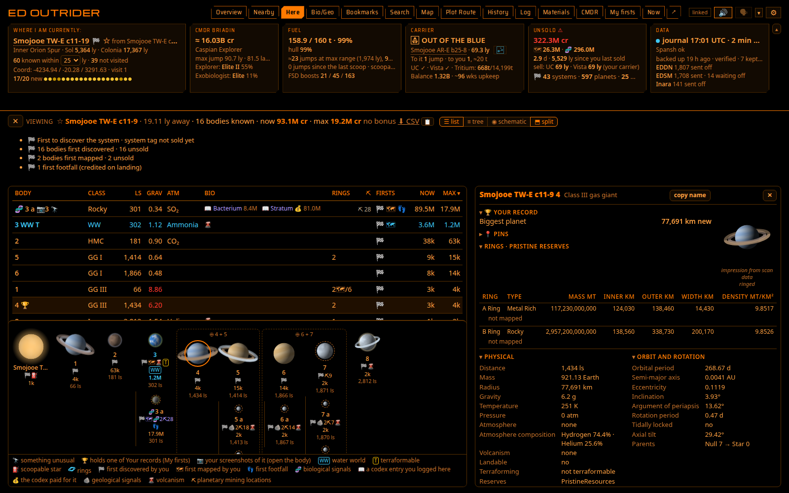
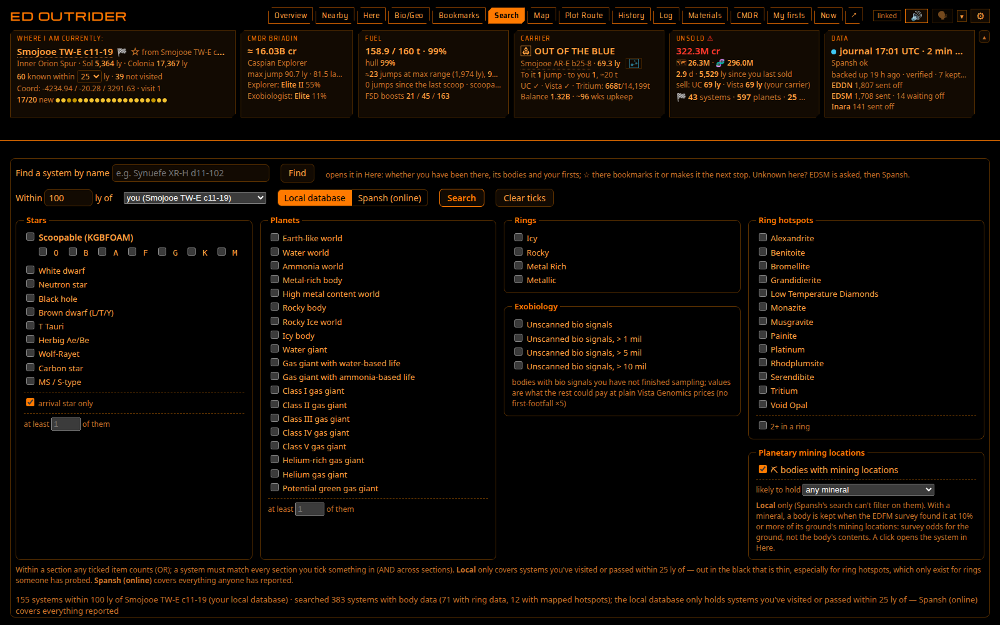
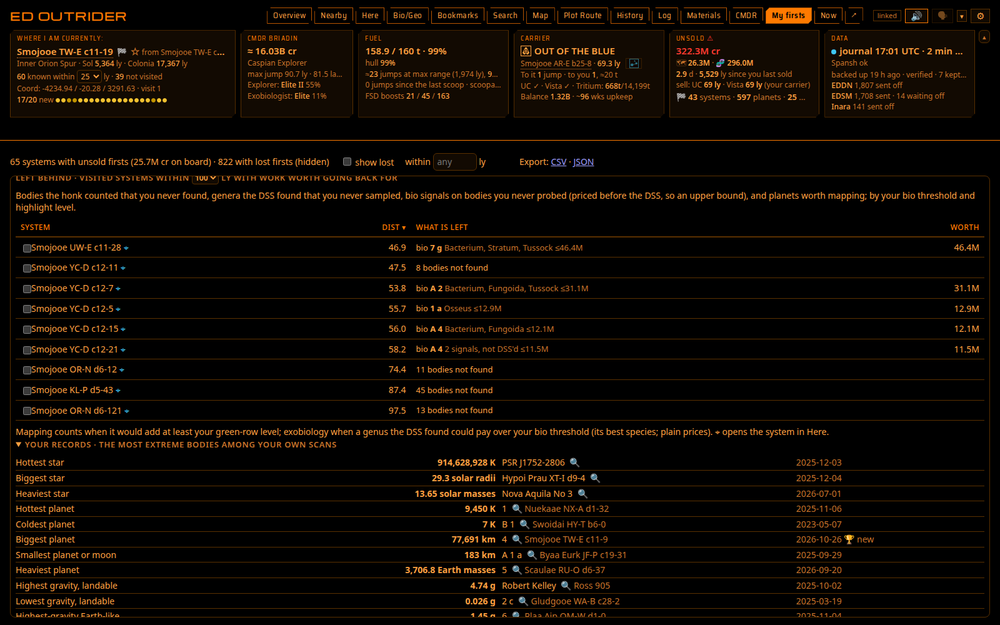
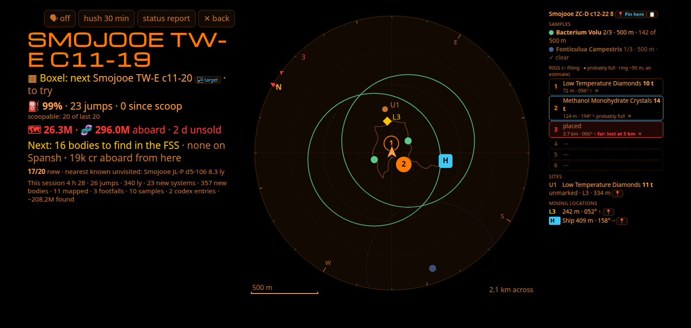

[ED Outrider](../../README.md) · [What's new](whats-new.md) · [Install and run](install.md) · **The views** · [Plot Route](plot-route.md) · [Cargo and trading](cargo-and-trading.md) · [Voice and alerts](voice-and-alerts.md) · [Automation](automation.md) · [On a tablet](tablet.md) · [In-game overlay](overlay.md) · [Uploads](uploads.md) · [Settings and good to know](settings.md) · [For the curious](for-developers.md)

# The views

## 🖥️ The views

<table>
<tr>
<td width="50%" valign="top">
<b>Nearby</b> — every known system within range (20–50 ly, the Where tile's dropdown): distance, how much
is scanned, the main star and whether it scoops, notable bodies, curiosities (🔭: odd orbits, ringed landables, rare
classes such as water giants, helium giants, Sudarsky class V and green gas giants) and a credit estimate. Sort,
hide visited and fully scanned systems, or keep only those one jump away. <i>🪦 pre-Odyssey</i> beside the status (🪦
alone when the pane is narrow) marks a system whose Spansh data was all reported before Odyssey's surface data (the
legacy split of 29 November 2022): its thin-atmosphere worlds were marked not landable and its life never reported, so
"fully scanned" there may still hide bio and first footfalls. Hover it for when, and the thin-atmosphere worlds that
may hold life: their names, what the exobiology rules allow there and about what one genus each would pay. A dashed <i>old data</i> mark flags such bodies in a system with newer data too. Here's
header says when Spansh's data was last reported ("Spansh: pre-Odyssey, 2019-02-14"), and Now says "Spansh data
pre-Odyssey (2019-02-14): Rescan for Bio" until your own scans have every body. Click a row to see that system
body by body beside the list (click it again to close it); its name copies it, ☆ bookmarks it, and where auto-target
can work (the game PC, see [Plot Route](plot-route.md)) the target button (the galaxy map's destination marker) left of the name, in a column of its own, targets it in
the galaxy map (not on your own system's row). ⛏ N counts planetary mining
locations on ground worth a Rhino. 🌀 N counts the notable stellar phenomena your FSS found there (life in clouds or rings; hover
for what they are), dimmed once you have been to them. ⭐ marks a rare star (a black hole, a Wolf-Rayet, a carbon,
MS, S or O-type star, a Herbig Ae/Be star, a supergiant, a rare white dwarf, an exotic star), from Spansh's records
too, so you see it before you go. 🏛 👾 ❔ mark Guardian sites, Thargoid sites and planetary anomalies on a system's bodies: your own scans (an anomaly shows once
the FSS finds it, Guardian and Thargoid sites only once the DSS has mapped the body), and what other commanders' mapping
reported to Spansh, so you see them before you go (the hover says "reported by others" until your own DSS counts them;
only your own scans are ever spoken); Here tags the body itself. 📍
counts FSS signals worth a detour (a Titan shows the galaxy map's Titan marker instead): Titans, Guardian beacons, generation ships, listening posts, number stations, tourist
beacons and memorials (hover for which).
  
</td>
<td width="50%" valign="top">
<b>Here</b> — the current system body by body: values, bio and geo signals, 🌋 volcanism, and before the
DSS the genera each bio signal could be. Hover a body for a summary, click it for everything, with a picture of
it drawn from its scan data (an impression: class colours, bands, clouds, atmosphere, rings, size). ⛏ gives a
community survey's mineral odds for that ground (odds, not contents) and what your SRV mined there before.
Rings shows the count and, once one is mapped, "1🗺/5": rings mapped and the hotspots in them ("2🗺/20" alone when
every ring is mapped); hover it for each ring's type and hotspots under it, the body's reserves (pristine, major...) and
your record there; the body's own hover card adds each ring's width and density. Click a body with hotspots and its
details add **Best nearby**: each hotspot mineral's best sell price within 100 ly (stations, from Spansh's markets),
highest first, so you know which hotspot to drop into; asked once in half an hour, then shown in the Rings hover too
("from you" for a system you are not in).
The to-do line ticks itself off as you honk, map and sample, in a suggested order with supercruise time and
credits per minute ("~2 min · 450k/min"; "skip?" when not worth the trip). Bio nobody has set foot on is
valued with the ×5 first-footfall bonus, except in a populated system: Vista Genomics never pays it there. A bio line's
✪ (✦: this region only) says a species that could be there is new to your codex; hover it for which. Before the DSS
the table and the body's hover mark each possible genus the same way.
A footer under the list says what each icon means, for the icons that system's list shows (none, no footer); it
stays in view while the list scrolls.
"🧬? check in the FSS" marks a landable body you have only from an AutoScan or a nav beacon, whose signals nobody
counted, where life is possible. A finished species is one line, its codex entry with what it pays ("📖 Bacterium
Alcyoneum - Red ✦ 8.3M"), the colour's word in that colour (Settings → Display can turn that off). The body panel lists
why each other genus is not expected ("pressure too low"). **👥** beside a genus is a species other commanders reported
to Spansh on that body, with the colour they reported ("👥 Bacterium Vesicula - Mulberry 1.0M"): a fact, not a guess
(asked once a day for the system you are in when its bodies have life; a genus you have analysed shows yours instead).
Hover a genus's guess for its candidates and, once you have finished runs of that genus on bodies like it (the same
class and atmosphere, within the same 25 K, in the same region once you have 5 such runs there), which species yours
were: "yours on bodies like this (Icy body, thin N2, 75–100 K, Inner Orion Spur): Informem 11 of 14, Acies 3 of 14".
The guess itself stays the likeliest by value, until you know better: a composition scan of a plant, from the ship as well as on foot, logs it in your codex ("📖 Bacterium Vesicula - Red"), and that species, its colour and what it pays replace the guess at once. Flying low over a body in your ship (under 5 km), the
on-body strip already shows its bio card. While you sample, the strip says what the run pays from the first sample on
("🧬 Bacterium Aurasus · 1.0M (×5: 5.0M) · sample 1/3 · 500 m to go": the species' value, and with the first-footfall
bonus). The distance counts down on foot, in the SRV or Nomad, and in your ship flying low to the next spot (measured
from the point under the ship), and "Clear to sample" is said as soon as you are far enough, before you land. A star's panel says its kind in words ("main sequence", "white dwarf (hydrogen-rich)"), a biology codex entry links to
Canonn's Bioforge (where it grows, and in what conditions), and **⬇ CSV** in the heading saves the system's bodies
and values as a spreadsheet; **📋** beside it copies a short summary in Markdown, ready to paste into Reddit or
Discord (your firsts, notable worlds, green gas giants, curiosities, the life sampled and still to sample, ring hotspots,
what it is worth).
  
</td>
</tr>
<tr>
<td width="50%" valign="top">
<b>Map</b> — a 3D view: left-drag to rotate, right-drag to move, scroll to zoom. Your path in orange,
your first discoveries in gold, visited systems in blue (or colour them by star class, or by **work left**: Left behind's
systems ringed amber (at its own radius), lost firsts to rescan red, unsold firsts gold, the hover naming what is left; by touch: one finger rotates, two move,
pinch zooms); tick <i>boost stars</i> for neutron stars and white dwarfs. The route ahead is dashed: the one plotted in
game, and the route Outrider follows (Plot Route's) from where you are, with ◎ on its next stop (else your next stop);
hover a stop for which it is. A click on a system targets it in the galaxy
map when auto-target can work on this PC, else copies its name (the card says which; a tap shows the card with
**Target**, Copy name and **Plot route**).
  
</td>
<td width="50%" valign="top">
<b>History</b> — sessions (jumps, light-years, discoveries, mapping, samples, what you sold, and ✗ for a
death: its hover says when and whether the ship was lost), an all-time row, "since your last sale" and the game's
career statistics. Below: every trip from sale to sale with what it paid
against Outrider's estimate, the exobiology ×5 checked against the prediction, credits per hour and per jump,
what each death cost, and your 25 most valuable finds.
  
</td>
</tr>
<tr>
<td width="50%" valign="top">
<b>Bio/Geo</b> — <b>My Samples</b>: every exobiology sample run: species, variant, body, value, and whether it is
<i>aboard</i>, <i>sold</i> or <i>lost</i>. Filter, sort, export; codex entries underneath. Unsold runs are
priced one by one ("x5 on 42 of 47 runs"); a sold run shows what Vista Genomics paid for it, the estimate in its hover
(≈ before an estimate where the sale was made before Outrider kept what each entry paid). Beside it, the <a href="#-the-exobiology-checklist">Exo-Biology and Geology
checklists</a>.
  
</td>
<td width="50%" valign="top">
<b>Log</b> — every journal event, newest first, one readable line each. Filter by category and time,
search any text, click a row for the raw event. A search answers in parts ("searching… 12 so far") and keeps looking
by itself, so a search that matches little shows what it has found while it goes on. With uploads on, each line
shows what they made of it (✓ EDDN · ⏳ EDSM, <a href="uploads.md#upload-marks-in-the-log">upload marks</a>), and <b>not sent</b> lists what is waiting or was refused.
  
</td>
</tr>
<tr>
<td width="50%" valign="top">
<b>Materials</b> — your <b>Cargo</b> (the ship's hold and your carrier's, with Sell and Buy: see <a href="cargo-and-trading.md">Cargo and trading</a>), materials against their caps, and how many of each synthesis you can make now: the FSD injections' cards,
then Ship upkeep (AFMU refills, heat sinks, life support, limpets), SRV (refuel, repair, Rhino rig restocks) and Other
recipes you have made, each folded into one line ("Ship upkeep ▸ AFMU refill B×4 S×1 P×0 · Heat sink B×12 S×0 P×0")
that opens on a click (remembered on this device). A recipe you have synthesised is ✓, checked against your own
synthesis and its date; the others are the published recipes. A material you are short of offers <b>⇄ nearest raw
trader</b> (or manufactured, encoded): the <a href="plot-route.md#-nearest-place-to-dock">Nearest finder</a> with that
trader asked for. <b>Mining sites</b> lists each body your SRV mined: minerals
and tons, saved spots, the last date and the distance.
  
</td>
<td width="50%" valign="top">
<b>Schematic</b> — Here switches between <i>list</i>, <i>tree</i> (orbital order) and <i>schematic</i>: stars
with their planets left to right, moons underneath, barycentres boxed, each scanned body drawn from its scan data (as
in the body panel: class colours, bands, oceans, clouds, atmosphere, rings). <i>Split</i> (on the Here tab, on by
default) keeps the schematic under the list or tree. In the system you are in, the suggested order's stops are
numbered on the bodies (①②③, two on a body with both mapping and bio; a stop not worth the trip greyed), with a faint
path between them and rough supercruise times (from each body's distance to the arrival star, not a route). Tap a
number to go there first: Now, the voice, the to-do line and the overlay follow; <i>↺ order</i> puts the suggested
order back.
  
</td>
</tr>
<tr>
<td width="50%" valign="top">
<b>Search</b> — systems with particular stars (or just <i>scoopable</i>), planets, rings, hotspots,
unfinished exobiology or planetary mining locations (one mineral, if you like) within a radius, from what
Outrider knows (<i>Local</i>) or everything reported (<i>Spansh</i>; mining locations are Local only, as Spansh cannot
filter on them); <i>2+ in a ring</i> keeps the rings with two or more hotspots of one mineral ticked (more places to
drop in, and where hotspots overlap); <i>at least N</i> under Stars or Planets keeps the systems with that many of the
kinds ticked (two Earth-likes, three neutron stars; with two kinds ticked, any mix of them); 🎯 after a result's name
targets it in the galaxy map, where auto-target can work. Planets has
<i>Potential green gas giant</i> too (see
<a href="#-potential-green-gas-giants">below</a>). The name box finds any system (what Outrider knows,
then EDSM, then Spansh when EDSM is down or doesn't know it) and opens it in Here, where ☆ bookmarks it or makes it the
next stop. <i>Within N ly of</i> searches around you, your destination in game, your carrier, your next stop or a
system you name: the distances are from there, and a result's hover says how far it is from you (remembered on this
device). Tick results to fly them as a <a href="plot-route.md">sweep</a>, with Left behind's, My firsts' and Bookmarks'
ticks.
  
</td>
<td width="50%" valign="top">
<b>My firsts</b> — visited systems with first-discovery data you haven't sold. The <b>firsts watch</b>
checks them on Spansh in the background and marks any someone else has scanned since you ("👁 8 d after you");
the first time it finds someone in one, a card and a notification say so (see
[Voice and alerts](voice-and-alerts.md#-alerts)); selling first still keeps your name if nobody sold before you. <b>Show lost</b> with <b>within N ly</b> is a
rescan checklist for data lost with a ship, nearest first, priced by what is left to scan and map, and the sample
runs that died with you ("+ 2 sample runs lost, 24M", a system with only those listed too). Back in such a system, Now's
Next line, the leaving warning, the status report and the arrival briefing name the scans still to redo ("Next: rescan
12 lost scans in the FSS"), never "nothing worth staying for". <b>Left behind</b> lists nearby systems with work over your
thresholds, nearest first; a click on System, Dist or Worth sorts by it (Worth: the most valuable first), kept per
device. <b>Your records</b>, folded at the end, lists the most extreme bodies among your own scans (hottest and biggest
star, hottest and coldest planet, highest and lowest gravity you could land on, the highest-gravity Earth-like, the
thickest atmosphere, the fastest spin, the widest ring...) and the system farthest from Sol you have been to; 🔍 opens
the body in Here. A record set in the last day is marked **🏆 new**, and in Here a body that holds one of your records
has a 🏆 beside its name (hover it for which).
  
</td>
</tr>
</table>

The **Overview** at the top shows Here and Nearby together: drag the divider, swap sides or stack them. Nearby's
Standard / Boxel switch and its Focus/Lock sit on its bar.

**Nearby around another system** (**Focus/Lock**, beside the Standard / Boxel switch; the idea of Rainmangames' pull
request #8): to sweep an area for unreported systems while you fly about in it.
- **You** (the default): the list follows your ship. **Lock this system** keeps it centred where you are now;
  **your destination**, **carrier** or **next stop** follow those; **a system…** takes a name. The choice is kept by
  Outrider itself, so every window and the tablet show the same, after a restart too.
- Away from you a strip above the list names the centre (click its name to copy it), how far it is from you and the
  sphere's size, with **↻ refresh** and **✕ back to you**. **Dist** is from the centre; a **From you** column and
  **Jumps** are from you. The Where tile says "known within 25 ly around …".
- Spansh is asked when the centre changes, and again only when you press ↻ (at most every 2 minutes): nothing on a
  timer. A system you visit inside the sphere joins the list at once, and your scans fill its rows as usual.
- A centre that names nothing now (no target, no carrier) says why, and the list stays around you meanwhile.
- Focus/Lock applies to Standard mode; a boxel has its own centre.
- **Filters** on Nearby's row of checkboxes, kept per device: **Mass** (one mass code, a to h: the letter before the number of a
  procedural name), **no scan data** (systems nobody has reported scanning), and **⧉ Copy visible** (the names of
  the rows shown, one per line). When Spansh returns its maximum, a line above the list says the list is complete only
  to so many light years: a smaller radius shows them all.

**Any view in a window of its own:** hover a tab and a small **↗** shows in its corner (or press Shift+Enter on the
tab); it opens that view alone in a new window, to drag to another monitor (pressed again, it brings that window
forward). Such a window has no tab row and leaves the main window's view as it was; ⌖ or a body opened from it shows
in Here in the main window while that is open (otherwise the window shows Here itself, with ↩ back). The main window
speaks, also after it reloads (**Speak from this window** makes such a window speak instead); Now has its own ↗
(below). The address is `http://127.0.0.1:8025/?view=bm` (bm, near, here, bio, search,
map, hwy, hist, log, mat, cmdr, firsts, overview).

**Bookmarks** is its own tab: the systems you have bookmarked (☆ beside any system), each with its note and distance.
The same ☆ sets your **next stop**, shown in the header until you get there. Where auto-target can work (the game PC) a **🎯** beside a bookmark
or the next stop targets it in the galaxy map, and **Plot route** puts it in Plot Route's To (plotted at once when you
follow no route). **Export** saves them as CSV or JSON (your surface pins too, as a file of their own, which Import takes as well); **Import…** beside it adds the bookmarks in such a file to yours
("12 added, 3 already there"): a system you have already bookmarked keeps your own note, and a row it cannot read is
left out with its line and the reason (a spreadsheet that turned a long id64 into 1.15292E+18 is the usual one; save
that column as text). Up to 10,000 bookmarks a file. The Android app has no Import… (it opens no file picker): import from a browser. **Plot Route** has its own page:
[Plot Route](plot-route.md).

On a window of at least about 900 × 600 the page fits the window: the header stays put and each list scrolls
in its own box. **▴** folds the tiles into one line (remembered on this device; Settings → Display can fold
them only on a small window, and untick the tiles this device leaves out, at least one staying). A table too wide for its box
switches to short forms ("HMC", "G star"; hover for the full text) rather than scroll sideways, then drops its least
useful columns; Nearby's status and notable tags go under the system's name and its bodies only when that is still
not enough, and then on every row.

**Themes.** ⚙ Settings → Display → **Theme on this browser** dresses the page in one of the tablet's themes: LCARS,
Elite, Babylon 5 (Earthforce, Narn, Minbari, Centauri, Vorlon, Shadows), Sith, Rebel Alliance or Dark, each with its colours, its
lettering on the title, tabs and labels, and its shapes. **Default - Outrider** is the look above, and the only one that
follows your system's light mode. Each browser keeps its own choice, and the tablet has its own.

  

**Now** is the cockpit view for a second monitor or a tablet, in big text: the system (and, from a docking grant until you
touch down, **PAD 34** in very large letters under it, where it is and, at a starport or carrier, its diagram (a carrier's
name after the galaxy map's fleet or squadron carrier marker); a
refusal's reason for a minute), the target, fuel,
what to do next, the body you have targeted, signals worth a detour ("Titan Cocijo · 📍 2 tourist beacons", a Titan after the galaxy map's Titan marker), any surface sites ("🏛 Guardian sites on 10 b"), any rare star here ("⭐ A black hole (main star)"), the notable stellar phenomena here ("🌀 Three notable stellar phenomena,
all in rings · 1 of 3 visited": each drop at one counts, since the journal cannot tell which of a kind's sites it was)
and the nearest unvisited system. Under the target, the jump's cost ("56.7 ly · 0.9 t · leaves 20 max jumps"); under the
fuel, "scoopable: 9 of last 20" (amber as on the fuel tile), and at the last scoopable star before a dry stretch "⛽ last
scoop before 3 dry" with how much to scoop. While you scoop, the fuel line counts down to a full tank ("38 s to full",
at the rate it is filling now: it slows at the edge of the scoop zone). The target says how much of it is
known ("3/12 known", Spansh's bodies of its count) and what EDSM has ("EDSM 5/12", or "not logged"): two databases
with different reporters; the hover says who first reported one of its bodies to EDSM, and when (EDSM's own record, not
the game's discovery tag), and Here's heading keeps "EDSM: since 2016" once you are there. While a new target is looked
up it says "checking…", never the previous target's verdict.

- **Where the next jump goes**, under the target: the route's next stop as the strip under the header says it ("🛣
  Next: Stop 38 · 4.2 ly · 38 of 120 · refuel in 3 jumps", or the Road to Riches / Exomastery one), and a kept boxel's
  Next (or the boxel followed, in Boxel mode): "▦ Boxel: next Smojooe KL-P d5-41 · to try" or "· known · 3 of 14
  bodies", each with 🎯 where auto-target can work.
- An **at-risk line** shows what is aboard against your rebuy ("🗺 380M · 🧬 412M aboard · 3.2× rebuy · 4 d
  unsold"), only once that is over your amber level or rebuy multiple; a ship bought with Arx (its hull has no credit
  value) gets no rebuy multiple. Docked where your data sells it says what
  selling here pays ("💰 sell here: 380M"); on a high-g approach it shows that approach's stakes instead.
- **While mining in a ring** (a mining ship, in normal space): a ⛏ line with the ring and hotspot, tons an hour, the
  hold and what it holds most, limpets and minutes to full ([Voice and alerts](voice-and-alerts.md) has its warnings).
- **This session** since your login: "2 h 14 · 74 jumps · 612 ly · 6 new systems · 11 mapped · 4 samples ·
  ~38.0M found" (the unsold estimate's change plus what you sold). After you quit, the last session.
- **Captions** show the last three lines said; tap one to hear it again. A corner bar has 🗣, hush 30 min,
  status report and ✕ back.
- **↗** beside the Now button opens Now in its own window, or open `http://127.0.0.1:8025/?mode=now`,
  which stays on Now even after a stray click or a reload.
- It keeps the screen awake on localhost or HTTPS. On a tablet over plain http, set its screen timeout.
- On a planet, the **surface map** appears under the lines (see below).

The **header** shows the galactic region, ranks, fuel, hull, any core module under your level (`module_warn`,
80%; as of the last Loadout or repair, since the journal logs nothing in between), your carrier's jump countdown
(its name after the galaxy map's fleet carrier marker, and its tritium while it is on a sell order: see [Cargo and trading](cargo-and-trading.md); where auto-target can work
🎯 beside its system, when it is elsewhere, puts it in the galaxy map; one movement line: a carrier trip's leg (see
[Plot Route](plot-route.md)), else a booked jump's countdown, else the jumps between you and it with the tritium for
its trip to you; "UC ✓ · Vista ✓ · Tritium: 668t/14,199t" (the depot, then all of it with the hold; a suspended UC or
Vista a red ✗; "Tritium: ≈534t" for the depot between readings, its burn since taken off); and its balance and weeks
of upkeep, counted down to today: "Balance 1.33B · ~83 wks upkeep now"), the nearest places to sell (your carrier
among them while its UC or Vista is on), and the last backup.

The **In-Game Route:** line under the tiles is the route the game plotted in the galaxy map (a route of more than one
jump: a system targeted next door has no line, the target says it; a longer route keeps its line to its last jump): its jumps and light years,
the next scoopable star, the longest stretch without one, and each star as a chip. A chip marked ✦ is a system nobody
has reported to Spansh (Outrider asks Spansh about the first 24 hops once you plot, except within 1,000 ly of Sol or
500 ly of Colonia, where Spansh knows every system); one without it is known there, or was not or could not be checked.
Click a chip to copy its system's name. A **⛽** between two chips marks how far the fuel in your tank goes without
scooping (for a ship with no fuel scoop: where you must refuel); it moves as your fuel changes, so scooping on the way
pushes it further. A jump counts only while it leaves **5 % of the tank** aboard (8 t in a 160 t tank), since the fuel
figures are a fit to your own jumps, not the game's sums; the mark's hover says what is kept or spare. **⛽✓** at the end:
your fuel makes the whole route; **⛽ 30** after the chips: it makes 30 jumps, past the ones shown; **⛽ ?**: Outrider
is still learning this ship's fuel use (the hover says how many more jumps). The game sometimes logs a plot but
never writes the route's file (NavRoute.json); Outrider then waits a minute for it and says what the game does tell:
"In-Game Route: 2 jumps left to Smojooe SJ-I b23-0 · the game didn't write the route's stars", without stars, distances
or fuel figures. If the line stays like that, clear the route in the galaxy map and plot a different destination: the
game writes the file again.

The **Data tile** says how fresh your journal is (the newer of the journal and Status.json, so a quiet journal in
supercruise or on foot does not turn it amber), the last backup, the uploads in use, and whether the outside lookups
answer: "Spansh ok", or just "Spansh unavailable" (EDSM, GitHub... the same) while one does not, and "No internet
connection" when two or more fail because this PC has no network. Meanwhile the lists show what Outrider kept from
earlier, and it asks again by itself. If Spansh or EDSM stays unavailable for 10 minutes, or this PC has no network,
a card says so at the top of the page (✕ hides it); it goes when they answer. The error itself is in Show log.
One failure is said in full, on the tile and at once on a card, because it is yours to fix: "couldn't verify
spansh.co.uk's certificate (expired): check this PC's date and time; if they are right, update Outrider" (see
[Windows: certificate errors](install.md#-getting-started)). Settings → Uploads' Recent list words it the same way.

The **fuel tile** counts jumps as the ship gets lighter ("≈6 jumps at max range (484 ly), 3,500 at your pace"),
for any drive, engineered or not, from your own Loadout and jumps. Nearby (and Now) shows laden range and the targeted
jump's cost ("38.2 ly · 0.9 t · leaves 5 max jumps"). "scoopable: 9 of last 20" turns amber when your fuel is
short for the gaps between scoopable stars. In the SRV or the Nomad it keeps the ship's tank and adds the
vehicle's own fuel.

The Where tile names the system you are in and, beside it, the one you jumped from ("from Xyz AB-C d1-2 (75.9 ly)");
the Commander tile has your jump range under the ship ("max jump 83.0 ly · 75.9 laden", and the boosted reach while a
jet-cone charge holds). Under the Where tile, the **discovery streak** is a dot per arrival for your last 20 (gold:
first discovery, amber: bodies nobody had reported, blue: known, grey: revisited). Now and the voice's status report
give the **unreported horizon**: "nearest known unvisited: Xyz 4.8 ly". Any unvisited star closer than that on the
galaxy map is one nobody has reported.

## 🟢 Potential green gas giants

A green gas giant looks like any other in the FSS: nothing flags it. The community's **seven-layer ladder** model
(CMDR Regza's, from a hint by Dr. K. Ross and CMDR Arcanic, whose edGGG catalogue it was fitted to) predicts which ones
render green from a giant's surface temperature, mass and radius. Outrider runs it on every gas giant it has the
journal's own figures for: your scans, and Spansh's records of other people's.

- **A green planet with "?"** marks a potential one: beside the body in Here, on the system's row in Nearby (a
  system worth going to), and a Now line ("Potential green gas giant: B 3 · check in the system map"). Without the
  "?" it is confirmed: your codex has its green entry (the game logs it on the system, not the giant, so with two giants
  of that class both get the mark, "one of these 2" in the hover).
- **"Potential green gas giant"** is said when one of your own scans fits (its own switch under Discoveries).
- "likely" is a confirmed rule of the model, "possible" a derived one. It is a guess about where to look: some kinds
  (Class II, V, helium giants) and some temperatures cannot be predicted at all, and nothing is said for them.
- **Finding one:** Search's *Potential green gas giant* (under Planets) runs the model over every giant in reach:
  *Local* over what Outrider has cached, *Spansh* over every giant Spansh knows of the kinds it can judge. By voice
  (the Android app): "nearest green gas giant" (Outrider's cache, within 500 ly). Expect few: the model calls very few
  giants green.

## ✦ Star and planet types and geology new to your codex

The codex logs every star and planet type once per region, the first time you scan one there (a K-type giant, a
terraformable water world, a rocky body with an atmosphere...). Outrider knows which entry each body would log and which
your codex has: the codex lines in your journals, and every type you have scanned yourself in a region (the game logs a
type the first time, so one you scanned without a line was logged before your journals begin; a nav beacon's data does
not count).

- **✦** beside a body in Here: its type is not in your codex for this region; **✪**: in your codex nowhere. The
  tooltip names the type ("K-type giant: new to your codex in this region").
- **On a Nearby row**, one tag for the system ("✦2"), each type and its bodies in the tooltip: Spansh's bodies count
  too, so a system can be picked for it before you go.

**Geology** too: a landable body with geological signals and volcanism gets **✦** (✪: anywhere) when its volcanism
could show a geological feature not in your codex for the region. One volcanism can show one of a few features (rocky
magma: a sulphur dioxide fumarole or gas vent, a silicate magma lava spout, now and then a silicate vapour gas vent), so
the tooltip names the new ones; the approach card says them too. The body's hover card and its details panel (a 🪨
section) list every kind its volcanism allows, the new ones marked ✪ or ✦. Your codex's geology is its lines in your journals (a
scan logs none), and combinations never seen on EDDN (water or CO2 features on a rocky body, anything on a rocky ice
body) get no mark.

Shown only, never spoken. A type the journals give no codex entry for (a class II giant star, a helium gas giant) gets
no mark, nor does a body Spansh lists without its luminosity or atmosphere. With no body type in your journals at all
(no codex line, no scan of your own) there is nothing to compare with, and nothing is marked.

## 📦 Boxel exploration

A procedural system name says which cube of space (a **boxel**) it is in and what kind of stars that cube makes:
in `Drojau TF-H c13-5` the **c** is the mass code (a 40 ly cube of K and M stars, some G) and **5** the system's number.
A boxel's systems are numbered 0, 1, 2… without gaps, so you can visit them in order.

**Nearby → Boxel** (the switch on the Overview's bar, and on Nearby's top bar on the Nearby tab;
one choice for both) lists the boxel you are in by number: systems you visited show your scans as Nearby does, ones
Spansh knows are marked "known" (someone has been there), the rest are "to try". Above the list: how many you have
visited, how many Spansh knows and the **highest known** number (yours or Spansh's). On the game PC, **Next** (with 🎯 where auto-target can work)
is the lowest number you have not visited, and every row has its own 🎯: auto-target types the name into the galaxy
map and checks the game targeted it, even for a system nobody has visited (Outrider works out its address from the
boxel).

  

- **⚠ Outrider cannot know how many systems a boxel holds.** It offers a few numbers above the highest known; explore
  until a name the galaxy map cannot find. When auto-target cannot find one above every known number, the list says
  "probably the end" (**retry** if it was only a hiccup).
- **✓ complete** shows by itself once the end is known and you have visited every system below it (**✓ empty** when
  the galaxy map found none of its names). **✓ Done with this boxel** is your call, complete or not (undo any time).
  Either way Next offers nothing more, the boxel leaves the recommendations (the next nearest of its kind takes its
  place; "done or complete nearby" lists them), and a kept boxel is let go.
- A system Spansh knows says how much of it anyone reported: "known · 3 of 14 bodies", "known · honked only", "known ·
  all 38 bodies". **Skip systems already fully scanned** (opt-in): Next and the auto-target pass over the ones with every
  body reported; one only passed through or partly scanned still has first discoveries to find.
- **📌 Keep this boxel** stays on it when you jump out. **Auto-target the next on arrival** (opt-in) targets the kept
  boxel's next system each time you arrive in one of its systems.
- **Boxels nearby** lists the nearest boxels of each mass code in sectors you have been to, with each one's highest
  known number, what each kind tends to hold, and your own figures for it ("from your 852 d systems: 41% with
  biology…"). **Explore this boxel** keeps one.
- **Sector map** draws the sector you are in as a grid of one mass code's boxels (b to h: a's 128 × 128 a layer is too
  many), one Y layer at a time (yours first, ▲ ▼ for the others, the layers holding your visits listed beside them):
  visited (with how many, on the coarser grids), ✓ complete, done, Spansh knows, you outlined, the kept boxel framed.
  +Z (toward the core) is up and +X right, as on the galaxy map. A tap explores that boxel.

  

- Hand-made sectors ("Col 285 Sector…") lay their boxels out differently: their list works, without 🎯 (Outrider
  cannot work out their systems' addresses).

## 🧬 The exobiology checklist

**Bio/Geo → Exo-Biology** shows every species the rules know, one box per genus, for a galactic region: where you
are (the default), any other, or **All regions**. Each species shows your best there, in colour:

- <b>sold</b> (green), <b>aboard</b> (amber: sampled, not sold yet), <b>lost</b> (red: sampled, lost with the ship),
  <b>logged</b> (blue: in your codex, no finished run);
- *elsewhere*: none here, but you have found it in another region (the line above the boxes counts them);
- greyed: not here, the rules say it cannot grow in this region. That is the rules' prediction, not proof that
  nobody has found it there;
- ◐: only in parts of the region (near Guardian sites, in tuber zones, by nebulae);
- a green **✓** beside a genus: complete there, every colour of every species that can grow in the region found;
- the colours you have found out of those it comes in (**3 / 12**). Anemones, brain trees and the like are their own
  one colour.

Click a species to drop its colours down under it, each with what gives it ("Teal: M stars", or a material on the
body for some bacteria) and your state; click it again to fold them up. The column beside the boxes shows its
picture and a map of the galaxy with the regions it can grow in lit and your samples as dots; hover a lit region
for its name and your completion there. The line above the boxes counts it up: "Inner Orion Spur: 45 of 101 possible species found ·
11.70% complete for the species in this region · 43 sold · …".

**🔍** beside a species you have not found (and **🔍 nearby** beside a colour of it you have not found, and in its
column) asks Spansh for the nearest bodies where commanders reported it, in that colour when you picked one: up to 25,
nearest first, each with its distance, gravity, the colours reported there, ✓ if you have been to the system, ☆ to
bookmark it, **Copy** for the name to paste into the galaxy map and, where auto-target can work, **🎯** to target it there. It needs the internet, and lists only what
commanders' uploads reported to Spansh.

**Completion** counts what you have done, not only what is finished: each species that can grow in the region scores
the share of its colours you have found there (sold, aboard, lost or logged), averaged over those species, so half of
every species is 50% with none complete. The region list shows each region's figure. The tablet's Bio/Geo page has it
all too, with the species and a species' details scrolling separately.

  

**Bio/Geo → Geology** is the same for the codex's **Geology and Anomalies** entries: fumaroles, gas vents, geysers and
lava spouts, then Lagrange clouds and the lettered anomalies. Each is logged in your codex for the region, or not;
beside it, how many sites players have reported in that region (from [Canonn](https://canonn.science)), greyed where
none have been reported yet (which is not to say there are none). Completion is the share of the entries reported in
the region that you have logged. Click one for its picture, its sites in the galaxy, where you logged it, and the map
of the regions it has been reported in. **🔍** on an entry you have not logged lists the nearest bodies where
commanders' mapping reported it to Spansh, as for a species (☆, Copy, 🎯).

The pictures are [Canonn](https://canonn.science)'s screenshots, each credited to the commander who took it: Outrider
links to them (they load from Canonn when you open an entry; click one for full size) and keeps no copy. Click a
colour under a species for that colour's picture. A few entries have none yet; Outrider asks Canonn for its latest
list once a day, so new pictures appear as they are added.

Journals from before a 2023 game update don't name a sample's colour, so those samples count the species but not a
colour.

The colour tables (which colours a species comes in, and what gives each) are downloaded on Outrider's first start. If
that failed (offline at the time), the checklist's line, the body panel's Bio section and Here's footer say "colours
unavailable: tables not downloaded · **Retry**", and a card at the top of the page has Retry too: it downloads only
those tables, and the colours show at once.

## 🗺️ The surface map

On a planet, Now shows a map under its lines: on the ground, in the SRV, on foot, or flying below 1,000 m
(it hides again 100 m higher). Hiding deletes nothing. The Overview shows the same map in the lower half of its system
pane (a body panel you open takes its place until you close it), with the body you are on brought to the top of the list
above it; the firsts and the checklist under the system's name give it their room.

  

- **Heading-up:** the way you face is the top, you are the arrow in the middle, N on the rim is north. It
  zooms to fit everything within 3 km, never narrower than 500 m, with a scale bar.
- **What is drawn:** your ship (a landing-pad H), the samples of unfinished bio runs with each species' colony ring (the
  current run solid), plants you tagged (below), your rigs 1–6 with a faint spacing ring, saved sites (U1…
  unmarked, S1… rigs picked up) and mining locations (L3). Anything off the map is a chevron on the rim.
- **Tagged plants** (as BioScan's waypoints): point the composition scanner at a plant, from the ship flying low,
  the SRV or on foot, and Outrider remembers where it is, as a hollow ring in the species' colour. Faint means a
  sample there would not count (it is inside the colony of one you took). While sampling, the strip says the
  nearest one that would count and which way to turn ("tagged: 524 m, turn 90° right"), and the voice says so
  within 100 m. From the ship or SRV the scanner logs no position, so it is yours at that moment: scan as close
  to the plant as you can. A species you have finished on the body drops its tags.
- **The legend** names each tag, nearest first. Six rig slots mirror the game's HUD: mineral (or
  "placed"), tons so far, distance and bearing. A solid rig is **probably full**: 8 minutes since it was
  placed or last collected from.
- **The leash:** the game destroys a rig 5 km from its Rhino. Past 3.5 km it turns red and the voice warns,
  again at 4.5 km ("Rig 3 is 3.8 kilometres away, behind you; it is lost at 5.": which way, in eight sectors).
- **Strip copy:** a tick in ⚙ Settings → Surface map adds a small copy to the on-body strip, with a one-line legend.

**Pins.** Named points on a body, kept until you delete them: the Anaconda wreck, Guardian ruins, a good spot to come
back to.

- **Adding one:** open the body's panel (Here or Overview, before you reach it too: from a Canonn page while still in
  supercruise), its **📍 Pins** section, and paste or type the coordinates: `-12.34, 45.67`, `Lat -12.34 Lon 45.67`,
  `12.34 S, 45.67 E`, text around them is fine; it shows what it read before you add it. On a body, **📍 Pin here** (by
  the map's legend title) pins where you are, and **📋** copies your coordinates to share. **📍** beside a site, a
  mining location or the ship in the legend pins it and takes you there.
- **Flying to one:** one pin is the target at a time: the one you tapped (in the legend or the panel), else the first
  not reached, in their order (▲ ▼ in the panel). From orbital cruise down, the strip and Now say how far and which
  way ("📍 Wreck: 12.4 km, turn 30° right"), the map draws it (on the rim when it is off the map) and the overlay's
  radar shows it with a line. The Navigator says it when it is set ("Wreck set. 340 kilometres, bearing 120."), at
  10 km, 1 km and 100 m, and on arrival (within 50 m on foot or in the SRV, 250 m in the ship), then the next pin's
  way; the status report starts with it. Reached pins are dimmed, with ↺ to undo.
- **Finding them again:** a 📍 beside a body with pins in Here and Overview, and every pin in **Bookmarks** (with
  Plot route to its system).

**Marking rigs.** The game logs nothing when you deploy or pick up a rig, so you tell Outrider with the
co-pilot button. In the Rhino on a planet:

- **Tap away from your rigs:** the next rig (lowest free number, 1–6) is placed 7 m behind you, where the
  game drops it. "Rig 3 placed."
- **Tap within 5 m of a rig:** it is picked up and its number is free again.
- The button does nothing else in the Rhino. Anywhere else it works as usual. Getting out on foot and back in
  keeps it marking rigs.
- **Forgot to tap?** The ✕ by a rig's slot in the legend marks it picked up.
- **Rigs still out:** docking the Rhino with rigs still marked out on the body says so, and a card shows it
  ("Rigs 2 and 5 still marked out; rig 5 is probably full."). It is Outrider's record, not the game's, so a
  rig picked up without a tap counts until you ✕ it.

**Automatic:** collections (the tons go to the rig under you, or an unmarked site, and are said once you
stop: "Rig 3: 12 tons of Water."), your ship's landing spot, mining locations you targeted from the ship, and
rigs lost at 5 km, on leaving the body, or with the Rhino destroyed, a death or a relog. **Not automatic:**
placing and picking up rigs, and what a deposit holds. A rig that collected anything is kept as a saved site
for your next visit and listed under Materials' **Mining sites**.

The map's sizes and the leash distance are in ⚙ Settings → Surface map; the spoken leash warning
always uses the config file's `rig_warn`.

## 🧑‍🚀 CMDR

What you are, what you own and what you have been doing, from all your journals: Outrider keeps it as it reads them
(nothing is asked of anyone), and a list updates as soon as the game writes something new for it. The tabs (Engineering
and Missions with the galaxy map's engineer and mission markers), Refresh, Engineering's filter and Earnings' period sit
above the list:

  

- **CMDR**: who you are in the game, as of your last login (the game writes ranks and statistics then): your
  credits as the Commander tile shows them (the login's plus what you sold since), net worth, the value of your fleet
  and stored modules, your carrier as the Carrier tile shows it (its balance and weeks of upkeep); every rank with a
  bar to the next one and, for exobiology, about how many credits it still takes (the community's figures for each
  rank's step, times the share your game says is left: an estimate; Elite IV and V are marked uncertain);
  reputation, Powerplay and squadron; your ships (a red ⚖ beside one the game marks hot: wanted, the one you fly
  included; **EDSY ↗** and **Coriolis ↗** open that ship's build in the ship designer, in a new tab, as the game last
  described it when you flew it; a ship you have not boarded since your journals begin says "no build"); and career figures (time played, systems visited, distance,
  profits by career; **History ›** opens History at its Career row, the game's statistics beside your sessions).
- **Inventory**: your ships (where each is, its value, what bringing it here costs), your stored modules with their
  engineering, the ship locker, and your suit loadouts. The game writes the list of stored ships when you open a
  shipyard: ships bought, sold, swapped, sent for or renamed since are followed, and each ship's value is its latest.
  Each ship has the same EDSY ↗ and Coriolis ↗ links as on the CMDR tab (in the Android app they open in your browser).
  Rest the mouse on a ship for 2 seconds to see a picture of its type, with its name; it goes when you move away (or
  press Escape). On the tablet, tap the ship's name (underlined with dots) to open the picture and tap anywhere to close
  it. The pictures are Frontier's ship designs, rendered from Elite Dangerous Almanac's illustrations; a ship type newer
  than Outrider has none yet, nor one Almanac has no illustration of yet (the Anaconda Mk II).
  Stored modules are as outfitting last listed them, with the modules stored, taken back, sent for or sold from
  storage since (one stored since shows its value once outfitting lists it again; one sent for is in transit until
  it arrives). A red ⚖ marks a ship or module the game says is hot (wanted). The ship locker is as the game last wrote it, in the journal or in
  its own file. A suit loadout is listed once you create or wear one, and goes when you delete it.

  

    
  

- **Engineering**: every ship-module blueprint by kind of module, grade by grade, with the materials one roll takes
  against what you hold (green: enough, red: short), how many rolls you could make now, and the engineers offering it
  for that kind of module (green: unlocked up to that grade). A material you are short of opens the Materials tab on
  it, and its **⇄** finds the nearest material trader of its kind. Filter by module, blueprint or material, or show
  only what you can craft now. Experimental effects and suit and weapon upgrades are not listed. The blueprints are a
  copy of EDCD's coriolis-data (community data): a recipe the game changes is wrong until the copy is updated.
- **Missions**: the missions you hold, the soonest to expire first: where they go, what they ask (and how much is
  delivered), the reward, and the time left, marked when under half an hour. A mining mission's 🔍 searches Spansh for
  where to mine its commodity within 100 ly: its hotspots, or for a mineral that has none (Bertrandite, Gold...) the ring
  types that yield it (Search's choices are replaced). Missions taken before this version have none.
- **Sessions**: your sessions of the last 30 days with fighting or mining in them (40 at most), each from one login to
  the next. Combat:
  kills, by ship, bounties and bonds, kills an hour, deaths. Mining: **Where** (the system and the ring, or the body your
  SRV mined on, with 🎯; "+1" when the session mined in more places, named in its hover), tons refined and of what (what the SRV's refinery
  collected on a planet is shown apart, and is not in the tons an hour), asteroids prospected and their content,
  limpets launched, and **Sold**: what the ore you mined sold for in that login, wherever and whenever you mined it (a
  login where you only sold shows 0 t refined). Tons you bought and sold with it, and sales to your own carrier, are
  not counted, the same rule as Earnings below.
  **Hotspots**: every ring you mined (all time), by hotspot: a stretch from your drop into the ring until you leave
  it counts as a stint. Per hotspot: stints, the **hit rate** (rocks not mined before that met the call-out's minerals
  and threshold in Settings → Mining, so it fills in once you tick some), your best ship's tons an hour there, **≈ cr/h**
  at what your mined ore actually sold for (* when some of its minerals never sold), tons refined and the last visit;
  sort by t/h, hit rate or last visit, 🎯 targets the system. The hotspot is the one you dropped on (Outrider reads it
  live; the game's journal never says which, so older mining shows "hotspot not known", and a drop on the ring itself
  "no hotspot"); a ring with several hotspots of one mineral counts them as one. Here's ring hover and body card add
  your record under each ring ("you, Alexandrite: 3 stints · 38 t/h · 41 % hits").
- **Earnings**: what exploration, exobiology and mining paid you, from every sale in your journals.
  - The figures: the total, cartography and exobiology (each its base and bonus, less your NPC crew's share while you
    had crew hired: the total is what you were paid), mining (the tons you mined and sold), and the data you lost to
    deaths (an estimate, from History's Ledger).
  - Above the list: **All time**, a year or a month of it, kept on this device. The chart shows every month,
    cartography, exobiology and mining stacked, the chosen ones highlighted; click a bar for that month.
  - Then: every sale (when, where, the ship, what, base, bonus, total), where you sold most, the species that paid
    most (the game's own figures), each ship's jumps, distance, bodies scanned, species sampled, earnings and active
    days, mining (refined by ship and by SRV, what the mined tons sold for, per ton, where, the best sales), the star
    classes, planet types and species you met most, and Outrider's estimates: the systems you sold by its value of your
    scans (the game pays per page of systems, not per system) and the data lost to deaths. Each estimate says so.
  - **⬇ CSV** saves every sale (in the Android app too).
  - Mining counts only ore you mined, from the refinery to its sale. Tons you bought and sell with it are trade, left
    out. Ore you store on your carrier keeps counting as mined: taken back aboard and sold, it is mining; ore you
    jettison comes off the count. Mined ore sold to your own carrier is left out: it is your own money changing pockets
    (taken back and sold elsewhere later, it counts then). Cartographic
    and exobiology data sold at your carrier counts (the game pays it).
  - Months are counted in UTC, as the game's journal times are: west of Greenwich, a sale late on a month's last
    evening counts in the next month.
  - Each trip's figures (sale to sale, with what deaths lost) are History's Ledger: **History › Trips**.
  - The first start after updating reads all your journals again once (a few minutes): that fills in where and with
    which ship you made every sale, and what you mined.

  

---

[ED Outrider](../../README.md) · [What's new](whats-new.md) · [Install and run](install.md) · **The views** · [Plot Route](plot-route.md) · [Cargo and trading](cargo-and-trading.md) · [Voice and alerts](voice-and-alerts.md) · [Automation](automation.md) · [On a tablet](tablet.md) · [In-game overlay](overlay.md) · [Uploads](uploads.md) · [Settings and good to know](settings.md) · [For the curious](for-developers.md)
