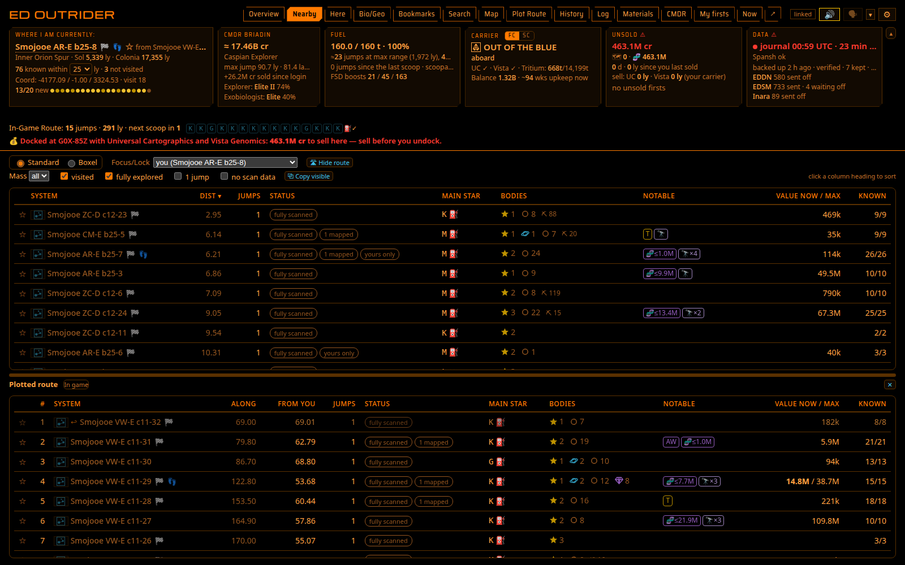
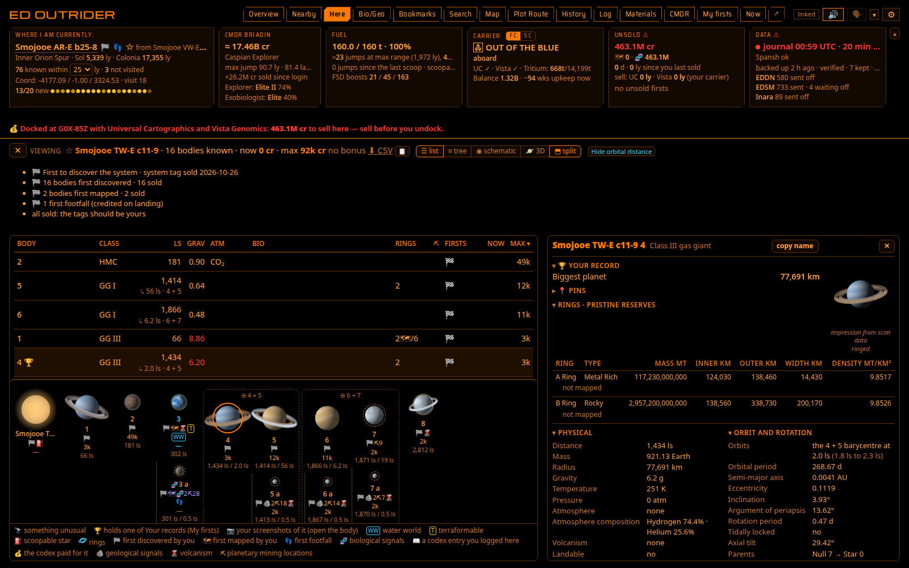
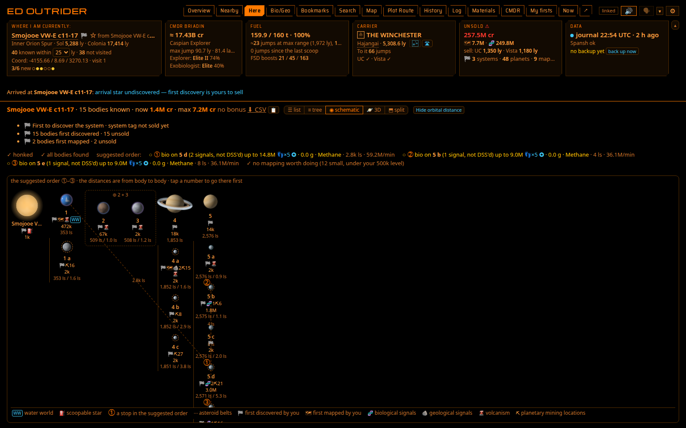
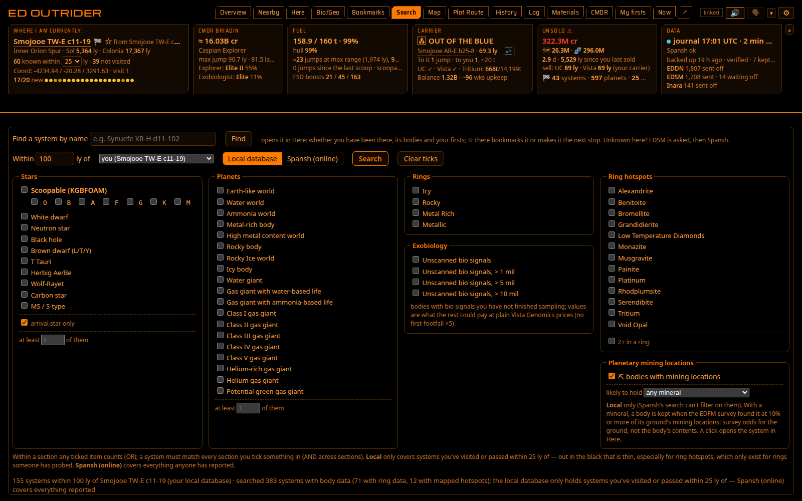
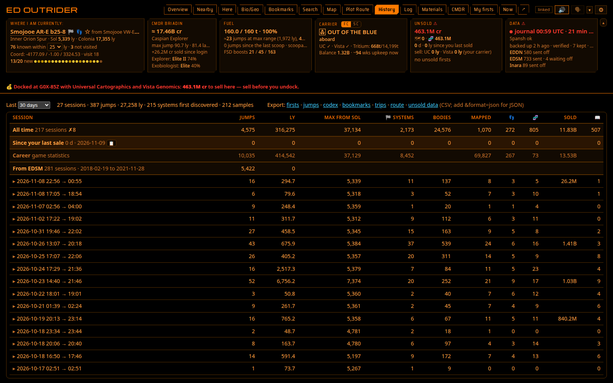
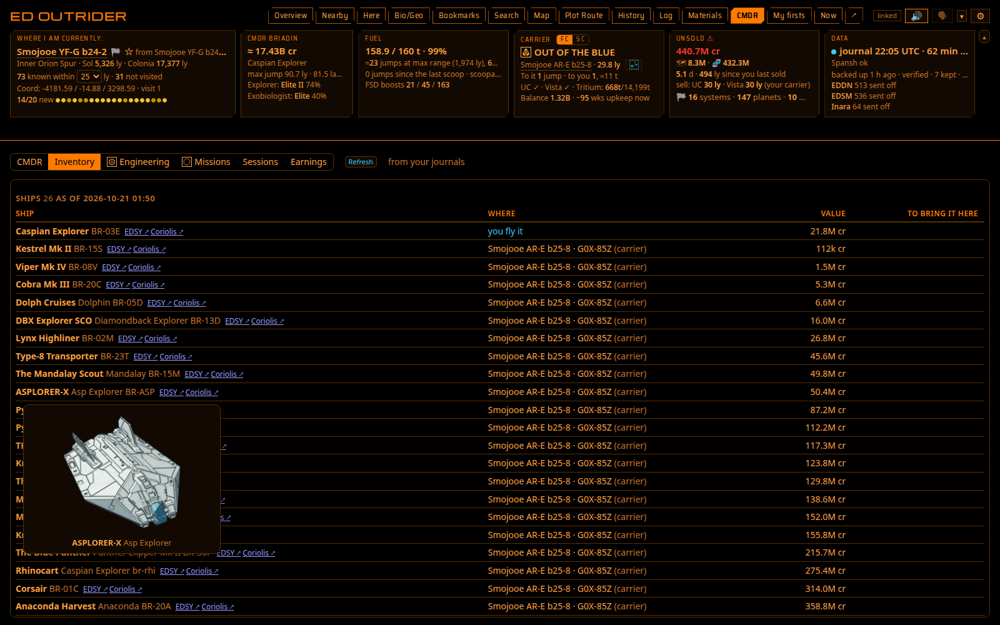
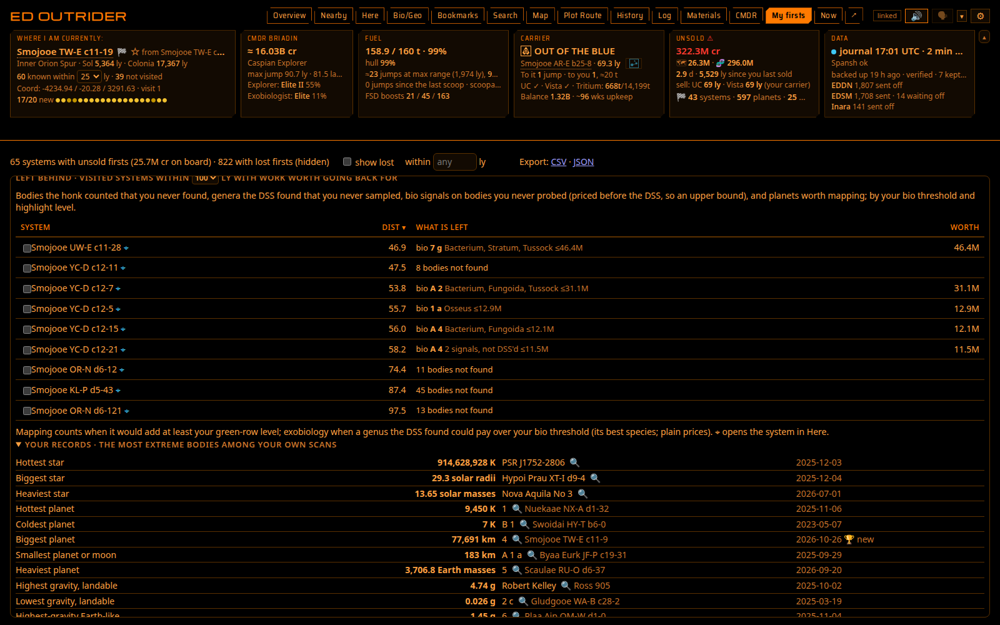

[ED Outrider](../../README.md) · [What's new](whats-new.md) · [Install and run](install.md) · **The views** · [Now](now.md) · [Exploring](exploration.md) · [Plot Route](plot-route.md) · [Cargo and trading](cargo-and-trading.md) · [Voice and alerts](voice-and-alerts.md) · [Automation](automation.md) · [On a tablet](tablet.md) · [In-game overlay](overlay.md) · [Uploads](uploads.md) · [Settings](settings.md) · [For the curious](for-developers.md)

# The views

## 🖥 The page

Outrider's page is a header of tiles above a row of tabs: Overview, Nearby, Here, Bio/Geo, Bookmarks, Search, Map,
Plot Route, History, Log, Materials, CMDR, My firsts and Now. This page covers the header and most of the tabs.
**Now** has a page of its own, [Now](now.md), and so does [Plot Route](plot-route.md).

### The link pill

The pill at the top right says whether the page is linked to Outrider: "linked", "linked · no game" (the game is not
running), or "unlinked · retrying" (after 30 s without an answer). The **⬆ Update** pill that can show beside it is
explained under [Updating](install.md#updating).

### Any view in a window of its own

Hover a tab and a small **↗** shows in its corner (or press Shift+Enter on the tab). It opens that view alone in a new
window, to drag to another monitor; pressed again, it brings that window forward.

- **No tab row:** such a window has no tab row and leaves the main window's view as it was.
- **Opening a body:** ⌖ or a body opened from it shows in Here in the main window while that is open. Otherwise the
  window shows Here itself, with ↩ back.
- **The voice:** the main window speaks, also after it reloads. **Speak from this window** makes such a window speak
  instead.
- **Now** has its own ↗ (see [Now](now.md)).
- **The address** is `http://127.0.0.1:8025/?view=bm` (bm, near, here, bio, search, map, hwy, hist, log, mat, cmdr,
  firsts, overview).

### Fitting the window

On a window of at least about 900 × 600 the page fits the window: the header stays put and each list scrolls in its
own box.

- **▴** folds the tiles into one line (remembered on this device). ⚙ Settings → Display can fold them only on a small
  window, and untick the tiles this device leaves out, at least one staying.
- **A table too wide for its box** switches to short forms ("HMC", "G star"; hover for the full text) rather than
  scroll sideways, then drops its least useful columns. Nearby's status and notable tags go under the system's name
  and its bodies only when that is still not enough, and then on every row.

### The clock

Beside the title is the time in UTC: the game's own clock, the one every journal time is in. ⚙ Settings → Display →
**Clock beside the title** switches it to your local time or off, on this device; its hover gives the other. It is
never on the tablet.

### Themes

⚙ Settings → Display → **Theme on this browser** dresses the page in one of the tablet's themes: LCARS, Elite,
Babylon 5 (Earthforce, Narn, Minbari, Centauri, Vorlon, Shadows), Sith, Rebel Alliance or Dark. Each comes with its
colours, its lettering on the title, tabs and labels, and its shapes. **Default - Outrider** is the look in the other
pictures on this page, and the only one that follows your system's light mode. Each browser keeps its own choice, and the tablet has its own.

  

## 🧩 The header and its tiles

The **header** across the top of the page shows:

- the galactic region and your ranks;
- fuel and hull;
- any core module under your level (`module_warn`, 80%). It is as of the last Loadout or repair, since the journal logs
  nothing in between;
- your carrier (the Carrier tile, below);
- the nearest places to sell (your carrier and your squadron's among them while its UC or Vista is on);
- the last backup.

### The Carrier tile

Your carrier's jump countdown, with its name after the galaxy map's fleet carrier marker. While it is on a sell order,
its tritium shows too (see [Cargo and trading](cargo-and-trading.md)).

- **🎯** beside its system, when it is elsewhere, puts it in the galaxy map, where auto-target can work.
- **One movement line:** a carrier trip's leg (see [Carrier trips](plot-route.md#-carrier-trips)), else a booked jump's
  countdown, else the jumps between you and it with the tritium for its trip to you.
- **Services and tritium:** "UC ✓ · Vista ✓ · Tritium: 668t/14,199t" gives the depot, then all of it with the hold. A
  suspended UC or Vista shows a red ✗. "Tritium: ≈534t" is the depot between readings, its burn since taken off.
- **Balance:** its balance and weeks of upkeep, counted down to today: "Balance 1.33B · ~83 wks upkeep now".

#### Your squadron's carrier

Your squadron's carrier shows on the Carrier tile too. With your own carrier as well, an **FC | SC** switch in the
tile's heading picks which one it shows. Docking at either shows that one, and your pick is kept on this device.

- **What it shows:** the galaxy map's squadron carrier marker and its name, where it is, how far, 🎯 and 🛣, your jumps
  to it, and UC and Vista.
  - Where it is: your journal's word at your last login, or Spansh's newer report of it elsewhere, marked "Spansh".
  - UC and Vista: Spansh's, or what it listed when you last docked.
- **A member** gets nothing more from the journal: no balance, cargo or tritium estimate (other members move and
  donate them).
- **An officer** who opens its management, or books a jump, gets the tritium reading and the countdown too, with the
  jump's length and where it leaves the carrier from you. They also get the same warning as your own carrier's when it
  is about to leave without you.
- **A paused service:** a service an officer pauses shows as "UC ✗" or "Vista ✗" and is left out of the places to sell.
- **Nearest place to dock** lists it as **your squadron's**, with no "squadron only" warning, and any carrier with a
  four-character callsign as a squadron carrier.

### The Data tile

The **Data tile** says how fresh your journal is, the last backup, the uploads in use, and whether the outside lookups
answer.

- **How fresh:** the newer of the journal and Status.json, so a quiet journal in supercruise or on foot does not turn
  it amber.
- **Lookups:** "Spansh ok", or just "Spansh unavailable" while it does not answer (EDSM, GitHub... the same). "No
  internet connection" shows when two or more fail because this PC has no network. Meanwhile the lists show what
  Outrider kept from earlier, and it asks again by itself.
- **A card:** if Spansh or EDSM stays unavailable for 10 minutes, or this PC has no network, a card says so at the top
  of the page (✕ hides it). It goes when they answer. The error itself is in
  [Show log](settings.md#-server-restart-show-log-and-backups).
- **A certificate error** is said in full, on the tile and at once on a card, because it is yours to fix: "couldn't
  verify spansh.co.uk's certificate (expired): check this PC's date and time; if they are right, update Outrider"
  (see [Windows: certificate errors](install.md#windows-certificate-errors)). Settings → Uploads' Recent list words it the same
  way.

### The fuel tile

The **fuel tile** counts jumps as the ship gets lighter ("≈6 jumps at max range (484 ly), 3,500 at your pace"). It
works for any drive, engineered or not, from your own Loadout and jumps.

- **The targeted jump:** Nearby (and Now) shows laden range and the targeted jump's cost ("38.2 ly · 0.9 t · leaves 5
  max jumps").
- **"scoopable: 9 of last 20"** turns amber when your fuel is short for the gaps between scoopable stars.
- **In the SRV or the Nomad** it keeps the ship's tank and adds the vehicle's own fuel.

### The Unsold tile

The **Unsold tile**'s values are estimates (see [What the values mean](#what-the-values-mean)). It also has a line while you hold bounty vouchers or combat bonds.

- **The line:** "⚖ vouchers 2.4M (bounties 1.8M · bonds 600k)", from your journals since your last death or
  redemption (a death loses them). Its hover, and the tile's details, list them by faction.
- **Docked:** at a station whose controlling faction you hold vouchers from, it says so ("Hub Independents controls
  this station: its 1.8M here"). Else, where there is one, it says "Interstellar Factors here (25 % cut)", for vouchers
  the station's Contacts will not take.
- **Silent:** nothing is said aloud, and the docked "sell your data" line never counts them.

### The Where and Commander tiles

- **The Where tile** names the system you are in and, beside it, the one you jumped from ("from Xyz AB-C d1-2 (75.9
  ly)"). Its dropdown sets Nearby's range.
- **The discovery streak**, under the Where tile, is a dot per arrival for your last 20. Gold: first discovery; amber:
  bodies nobody had reported; blue: known; grey: revisited.
- **The Commander tile** has your jump range under the ship ("max jump 83.0 ly · 75.9 laden", and the boosted reach
  while a jet-cone charge holds).

### The unreported horizon

Now and the voice's status report give the **unreported horizon**: "nearest known unvisited: Xyz 4.8 ly". Any
unvisited star closer than that on the galaxy map is one nobody has reported.

## 🛣 The route lines and the Plotted route pane

The game's plotted route has a line under the tiles, and **🛣 Show route** lists the systems on it (or on any other
route you have). The route Outrider
follows (Plot Route's) has its own line: see [Following a route](plot-route.md#-following-a-route).

### The In-Game Route line

The **In-Game Route:** line under the tiles is the route the game plotted in the galaxy map: its jumps and light years,
the next scoopable star, the longest stretch without one, and each star as a chip.

- **Only for a route of more than one jump:** a system targeted next door has no line; the target says it. A longer
  route keeps its line to its last jump.
- **✦ on a chip** marks a system nobody has reported to Spansh. Outrider asks Spansh about the first 24 hops once you
  plot, except within 1,000 ly of Sol or 500 ly of Colonia, where Spansh knows every system. A chip without it is known
  there, or was not or could not be checked.
- **Click a chip** to copy its system's name. Its hover adds Spansh's body count and when its record was last updated,
  where Spansh was asked.
- **⛽ between two chips** marks how far the fuel in your tank goes without scooping (for a ship with no fuel scoop:
  where you must refuel). It moves as your fuel changes, so scooping on the way pushes it further.
  - A jump counts only while it leaves **5 % of the tank** aboard (8 t in a 160 t tank), since the fuel figures are a
    fit to your own jumps, not the game's sums. The mark's hover says what is kept or spare.
  - **⛽✓** at the end: your fuel makes the whole route.
  - **⛽ 30** after the chips: it makes 30 jumps, past the ones shown.
  - **⛽ ?**: Outrider is still learning this ship's fuel use (the hover says how many more jumps).
- **When the game writes no route file:** the game sometimes logs a plot but never writes the route's file
  (NavRoute.json). Outrider then waits a minute for it and says what the game does tell: "In-Game Route: 2 jumps left
  to Smojooe SJ-I b23-0 · the game didn't write the route's stars", without stars, distances or fuel figures. If the
  line stays like that, clear the route in the galaxy map and plot a different destination: the game writes the file
  again.

### 🛣 Show route: the Plotted route pane

**🛣 Show route** sits in Nearby's heading (on the Overview, on the Overview's bar) while you have a route. It opens the
**Plotted route** pane under the list: the next 24 systems on the route, with Nearby's columns (status, main star,
bodies, notable, value, known), so you see what is out there before you go.

- **#** is the jump number from you. A Highway row counts the jumps it stands for; a survey route or a carrier trip
  numbers its stops.
- **Along** is the light years along the route; **From you** is straight.
- **More than one route** (the game's, the Highway's, a survey or trade route, a carrier trip): a switch at the top
  picks which. The game's comes first.
- **Spansh** is asked about these systems only while the pane is open ("asking Spansh: 3 of 12…"), and once per
  system: flying that stretch again asks nothing.
- **Size:** drag the bar between the list and the pane to resize it. In a small window or a phone browser the pane
  takes the list's place instead (🛣 Hide route brings the list back).
- **✕** closes it. This device remembers whether it was open, the route picked and its size.

## 🔭 Overview and Nearby

The **Overview** at the top shows Here and Nearby together: drag the divider, swap sides or stack them. Nearby's
Standard / Boxel switch (see [Boxel exploration](exploration.md#-boxel-exploration)) and its Focus/Lock sit on its bar.

**Nearby** lists every known system within range (20–50 ly, the Where tile's dropdown): distance, how much is scanned,
the main star and whether it scoops, notable bodies, curiosities and a credit estimate.

> [!NOTE]
> **"Not on the page" means "nobody with an uploader has reported it."** Players who don't run
> EDMC or a similar tool never reach Spansh or EDSM, so a missing system is *almost* certainly
> undiscovered. A second after you arrive, the arrival star's scan settles it — and the page
> (and the voice) says which it was.

### The rows

- **Click a row** to see that system body by body beside the list (click it again to close it).
- **Its name** copies it; **☆** bookmarks it.
- **The target button** (the galaxy map's destination marker), left of the name in a column of its own, targets it in
  the galaxy map. It shows where auto-target can work (the game PC, see
  [Targeting and auto-target](plot-route.md#-targeting-and-auto-target)), and not on your own system's row.

### The marks

- **🔭** is a curiosity: odd orbits, shepherd moons inside their planet's rings, close binary stars, tiny worlds and
  stars, ringed landables, rare classes such as water giants, helium giants, Sudarsky class V and green gas giants.
- **⛏ N** counts planetary mining locations on ground worth a Rhino.
- **✦ inside the 🧬 tag** says a species there is surely new to your codex in that region, whatever the signals turn
  out to be (**✪**: new to your codex anywhere). Hover the tag for the bodies and species.
  - Only a sure one is marked (a guess about a place you have not scanned), and it goes as soon as you log the species.
  - The Plotted Route pane's rows show it too.
- **🌀 N** counts the notable stellar phenomena your FSS found there (life in clouds or rings; hover for what they are),
  dimmed once you have been to them.
- **⭐** marks a rare star: a black hole, a Wolf-Rayet, a carbon, MS, S or O-type star, a Herbig Ae/Be star, a
  supergiant, a rare white dwarf, an exotic star. It comes from Spansh's records too, so you see it before you go.
- **🏛 👾 ❔** mark Guardian sites, Thargoid sites and planetary anomalies on a system's bodies. Here tags the body itself.
  - They come from your own scans: an anomaly shows once the FSS finds it, Guardian and Thargoid sites only once the
    DSS has mapped the body.
  - They also come from what other commanders' mapping reported to Spansh, so you see them before you go. The hover
    says "reported by others" until your own DSS counts them; only your own scans are ever spoken.
- **📍** counts FSS signals worth a detour: Titans, Guardian beacons, generation ships, listening posts, number
  stations, tourist beacons and memorials (hover for which). A Titan shows the galaxy map's Titan marker instead.
- **🏆** beside a system's name, in standard or Boxel view, says it holds one of your records (see
  [My firsts](#-my-firsts)). Its hover names the record and the body; the system's card (hover its bodies) lists them
  too.
- ***🪦 pre-Odyssey*** beside the status (🪦 alone when the pane is narrow) marks a system whose Spansh data was all
  reported before Odyssey's surface data (the legacy split of 29 November 2022). Its thin-atmosphere worlds were marked
  not landable and its life never reported, so "fully scanned" there may still hide bio and first footfalls.
  - Hover it for when, and the thin-atmosphere worlds that may hold life: their names, what the exobiology rules allow
    there and about what one genus each would pay.
  - A dashed *old data* mark flags such bodies in a system with newer data too.
  - Here's header says when Spansh's data was last reported ("Spansh: pre-Odyssey, 2019-02-14"). Now says "Spansh data
    pre-Odyssey (2019-02-14): Rescan for Bio" until your own scans have every body.

### Nearby around another system

**Focus/Lock**, beside the Standard / Boxel switch, centres Nearby somewhere other than your ship: to sweep an area for
unreported systems while you fly about in it. (The idea of Rainmangames' pull request #8.)

- **You** (the default): the list follows your ship. **Lock this system** keeps it centred where you are now; **your
  destination**, **carrier** or **next stop** follow those; **a system…** takes a name.
- **Kept by Outrider:** the choice is kept by Outrider itself, so every window and the tablet show the same, after a
  restart too.
- **Away from you,** a strip above the list names the centre (click its name to copy it), how far it is from you and
  the sphere's size, with **↻ refresh** and **✕ back to you**. **Dist** is from the centre; a **From you** column and
  **Jumps** are from you. The Where tile says "known within 25 ly around …".
- **Spansh** is asked when the centre changes, and again only when you press ↻ (at most every 2 minutes): nothing on a
  timer. A system you visit inside the sphere joins the list at once, and your scans fill its rows as usual.
- **A centre that names nothing now** (no target, no carrier) says why, and the list stays around you meanwhile.
- **Standard mode only:** Focus/Lock applies to Standard mode; a boxel has its own centre.

### Filters

Sort the list, hide visited and fully scanned systems, or keep only those one jump away. Nearby's row of checkboxes
adds these, kept per device:

- **Mass:** one mass code, a to h (the letter before the number of a procedural name).
- **no scan data:** systems nobody has reported scanning.
- **⧉ Copy visible:** the names of the rows shown, one per line.

When Spansh returns its maximum, a line above the list says the list is complete only to so many light years: a
smaller radius shows them all.

## 🪐 Here

**Here** shows the current system body by body: values, bio and geo signals, 🌋 volcanism, and before the DSS the
genera each bio signal could be. It switches between *list*, *tree* (orbital order) and *schematic*.

### The list and its columns

- **Hover a body** for a summary. **Click it** for everything, with a picture of it drawn from its scan data (an
  impression: class colours, bands, clouds, atmosphere, rings, size).
- **Sorting:** the Dist, Grav, Now and Max headings sort the bodies.
- **⛏** gives a community survey's mineral odds for that ground (odds, not contents) and what your SRV mined there
  before.
- **🔭** beside a body is a curiosity. Hover it for why; its panel has a 🔭 Curiosities section.
- **🏆** says it holds one of your records ([My firsts](#-my-firsts)' Your records); hover it for which. The body's
  hover card and the top of its panel name each one with its figure ("Biggest planet 77,691 km"), "new" when set in
  the last day.
- **The footer** under the list says what each icon means, for the icons that system's list shows (none, no footer).
  It stays in view while the list scrolls.
- **⬇ CSV** in the heading saves the system's bodies and values as a spreadsheet. **📋** beside it copies a short
  summary in Markdown, ready to paste into Reddit or Discord: your firsts, notable worlds, green gas giants,
  curiosities, the life sampled and still to sample, ring hotspots, what it is worth.

### What the values mean

- **Values are estimates** using the community tools' formula, bonuses included. That includes the full-scan bonus:
  1,000 cr per body of a system you found complete while all of it was undiscovered. An NPC crew member's cut comes off
  automatically, based on what your past sales paid.
- **First footfall:** bio nobody has set foot on is valued with the ×5 first-footfall bonus, except in a populated
  system: Vista Genomics never pays it there.
- **Losing your ship loses your data.** Discoveries and samples that went down show as *lost* until you scan them
  again. Scanning a body you've already sold adds nothing; only mapping it still pays.

### The to-do line and the suggested order

The to-do line ticks itself off as you honk, map and sample, in a suggested order.

- **The order** is the shortest supercruise from where you are, body to body by where each body is on its orbit now.
  It is worked out again as you go. A new order comes only when it saves at least a tenth of the time left or 30 s,
  so the numbers do not shuffle for nothing.
- **Each stop** has its distance from the one before and what it pays per minute of the time it adds ("1.5k ls ·
  450k/min"). "≈" shows when the distance is about; "skip?" when the stop is not worth the trip.
- **Distances, never times:** with Supercruise Overdrive the minutes would be wrong, though the order is still worked
  out on supercruise time.
- **Changing it:** the schematic numbers the stops; tap one to go there first, or skip a body
  ([The schematic](#the-schematic), below).

### Orbit distances

- **↳**, under a moon's or another star's planet's distance from arrival, gives how far it is from what it orbits
  ("↳ 15 ls · B"; "↳ 6,595 km · A 3 + A 4" for a pair round their barycentre).
- **Its hover card and panel** say "orbits B at 15 ls", with the closest and farthest points of an eccentric orbit.
- **The schematic** puts both under the body, "2,026 ls / 2.6 ls" (from arrival / from what it orbits, the body drawn
  above or beside it).
- **It is the orbit's size** (its semi-major axis), not today's distance. The arrival star's own planets have none
  (their distance from arrival says it).
- **Hide orbital distance**, right of list / tree / schematic, leaves that line out for shorter rows (the schematic's
  "/ 2.6 ls" too; the body's panel keeps it). **Show orbital distance** brings it back. This device remembers it.

### Bio and the body panel

Here's bio column shows each body's bio signals and, before the DSS, the genera each could be. How the guesses are
made is in [How the exobiology guesses work](exploration.md#-how-the-exobiology-guesses-work).

- **"bio possible: check the FSS"** (🧬? in a narrow pane) marks a landable body you have only from an AutoScan or a nav
  beacon, whose signals nobody counted, where life is possible.
- **A genus's guess:** hover it for its candidates. Once you have finished runs of that genus on bodies like it, the
  hover adds which species yours were: "yours on bodies like this (Icy body, thin N2, 75–100 K, Inner Orion Spur):
  Informem 11 of 14, Acies 3 of 14". Bodies like it means the same class and atmosphere, within the same 25 K, and in
  the same region once you have 5 such runs there.
- **Until you know better** the guess stays the likeliest by value. A composition scan of a plant, from the ship as
  well as on foot, logs it in your codex ("📖 Bacterium Vesicula - Red"). That species, its colour and what it pays
  replace the guess at once.
- **A genus's tooltip** gives its colony distance.
- **✪** on a bio line (✦: this region only) says a species that could be there is new to your codex; hover it for
  which. Before the DSS the table and the body's hover mark each possible genus the same way.
- **👥** beside a genus is a species other commanders reported to Spansh on that body, with the colour they reported
  ("👥 Bacterium Vesicula - Mulberry 1.0M"): a fact, not a guess. It is asked once a day for the system you are in
  when its bodies have life. A genus you have analysed shows yours instead.
- **A finished species** is one line, its codex entry with what it pays ("📖 Bacterium Alcyoneum - Red ✦ 8.3M"). The
  colour's word shows in that colour (Settings → Display can turn that off).
- **📷** beside a species (sampled, being sampled, or logged with the composition scanner) says your codex folders
  already hold a picture of that colour (Settings → Screenshots, see [Screenshots](automation.md#-screenshots)), so
  another shot is not needed.
- **Pictures:** on a PC, a mouse over a species' name (one you sample, one finished, the likeliest guess) shows a
  picture of it, as in the [surface map](now.md#-the-surface-map)'s legend: one of your own at random, else Canonn's.
  The body's hover card gives way meanwhile. The body panel's Bio rows do the same.

**The body panel** (click a body):

- lists why each other genus is not expected ("pressure too low");
- for a star, says its kind in words ("main sequence", "white dwarf (hydrogen-rich)");
- links a biology codex entry to Canonn's Bioforge (where it grows, and in what conditions).

#### Flying low and sampling

- **Flying low** over a body in your ship (under 5 km), the on-body strip already shows its bio card.
- **While you sample,** the strip says what the run pays from the first sample on ("🧬 Bacterium Aurasus · 1.0M (×5:
  5.0M) · sample 1/3 · 500 m to go": the species' value, and with the first-footfall bonus).
- **The distance** counts down on foot, in the SRV or Nomad, and in your ship flying low to the next spot (measured from
  the point under the ship). "Clear to sample" is said as soon as you are far enough, before you land.
- **The wrong suit:** on foot in a suit with no Genetic Sampler (any but the Artemis) on a body with sampling left, the
  strip ends with "⚠ Maverick suit: no Genetic Sampler". Not where you approached a settlement on the body, nor while
  you hold an on-foot mission; see [the wrong suit](voice-and-alerts.md#-alerts).

### Rings and Best nearby

- **Rings** shows the count and, once one is mapped, "1🗺/5": rings mapped and the hotspots in them ("2🗺/20" alone when
  every ring is mapped).
- **Hover it** for each ring's type and hotspots under it, the body's reserves (pristine, major...) and your record
  there (see [CMDR's Hotspots](#sessions-and-hotspots)). The body's own hover card adds each ring's width and density.
- **Best nearby:** click a body with hotspots and its details (here or in Search) add each hotspot mineral's best sell
  price within 100 ly (stations, from Spansh's markets), highest first, so you know which hotspot to drop into.
  - It is asked once in half an hour, and again after a jump: the distances are from where you are ("from you" for a
    system you are not in).
  - It is then shown in the Rings hover too.
  - When the lookup fails it says so, and asks again a few minutes later.

### The schematic

The *schematic* draws stars with their planets left to right, moons underneath, barycentres boxed. Each scanned body
is drawn from its scan data, as in the body panel: class colours, bands, oceans, clouds, atmosphere, rings.

- ***Split*** (on the Here tab, on by default) keeps the schematic under the list or tree.
- **The suggested order's stops** are numbered on the bodies in the system you are in (①②③; two on a body with both
  mapping and bio; a stop not worth the trip greyed).
  - A faint path joins them from where you are: the body you are at or were last at, else the arrival star.
  - Each leg has its distance, from body to body where the bodies are now. "≈" shows when it is about: from one star's
    family to another's in a multi-star system, or an orbit your scans do not give.
- **Tap a number** to go there first: Now, the voice, the to-do line and the overlay follow. *↺ order* puts the
  suggested order back.
- **A body you Skip** on the system map is left out here too, from the order and the numbers, until you leave the
  system. The to-do line names it ("skipped: 5 b") with *↺ order*, which puts all of them back. The system map's
  **skipped:** line (Now, or 🪐 3D here) puts one back.
- ***🪐 3D*** draws the system you are in as [the system map](now.md#-the-system-map) does.

## 🧬 Bio/Geo

The Bio/Geo tab holds **My Samples**, every exobiology sample run with its value and whether it is aboard, sold or
lost, and beside it the Exo-Biology, Geology and Phenomena checklists. Both are on Exploring and exobiology:
[Bio/Geo: My Samples](exploration.md#-biogeo-my-samples) and
[the exobiology checklist](exploration.md#-the-exobiology-checklist).

## ☆ Bookmarks

**Bookmarks** lists the systems you have bookmarked (☆ beside any system), each with its note and distance.

- **Next stop:** the same ☆ sets your **next stop**, shown in the header until you get there.
- **🎯** beside a bookmark or the next stop targets it in the galaxy map, where auto-target can work (the game PC).
- **Plot route** puts it in Plot Route's To (plotted at once when you follow no route).
- **Export** saves them as CSV or JSON. Your surface pins go too, as a file of their own, which Import takes as well
  (see [Pins](now.md#-pins)).
- **Import…** beside it adds the bookmarks in such a file to yours ("12 added, 3 already there"). Up to 10,000
  bookmarks a file.
  - A system you have already bookmarked keeps your own note.
  - A row it cannot read is left out with its line and the reason. A spreadsheet that turned a long id64 into
    1.15292E+18 is the usual one; save that column as text.
  - The Android app has no Import… (it opens no file picker): import from a browser.

## 🔍 Search

**Search** finds systems with particular stars (or just *scoopable*), planets, rings, hotspots, unfinished exobiology
or planetary mining locations (one mineral, if you like) within a radius.

- **Local or Spansh:** it searches what Outrider knows (*Local*) or everything reported (*Spansh*).
- **Mining locations** are Local only, as Spansh cannot filter on them. The mining list includes minerals you have
  refined, with those bodies first.
- ***2+ in a ring*** keeps the rings with two or more hotspots of one mineral ticked: more places to drop in, and where
  hotspots overlap.
- ***at least N*** under Stars or Planets keeps the systems with that many of the kinds ticked (two Earth-likes, three
  neutron stars). With two kinds ticked, any mix of them counts. For stars it counts every star of the system, so
  *arrival star only* is greyed then.
- ***Potential green gas giant*** is under Planets too (see
  [Potential green gas giants](exploration.md#-potential-green-gas-giants)).
- ***Within N ly of*** searches around you, your destination in game, your carrier, your next stop or a system you
  name. The distances are from there, and a result's hover says how far it is from you (remembered on this device).
- **The name box** finds any system and opens it in Here, where ☆ bookmarks it or makes it the next stop. It looks in
  what Outrider knows, then EDSM, then Spansh when EDSM is down or doesn't know it.
- **🎯** after a result's name targets it in the galaxy map, where auto-target can work.
- **Tick results** to fly them as a [sweep](plot-route.md#-a-sweep), with Left behind's, My firsts' and Bookmarks'
  ticks.

## 🗺 Map

**Map** is a 3D view: your path, your discoveries and the route ahead.

- **Moving about:** left-drag to rotate, right-drag to move, scroll to zoom. By touch: one finger rotates, two move,
  pinch zooms.
- **Colours:** your path in orange, your first discoveries in gold, visited systems in blue.
  - Or colour them by star class.
  - Or by **work left**: Left behind's systems ringed amber (at its own radius), lost firsts to rescan red, unsold
    firsts gold, the hover naming what is left.
- ***boost stars***: tick it for neutron stars and white dwarfs.
- **Jump range:** a dashed ring round you is your jump range. At a neutron star or white dwarf a second one shows its
  boosted reach (×4, ×6 with the SCO Mk II drive; ×1.5 at a white dwarf).
- **The route ahead** is dashed: the one plotted in game, and the route Outrider follows (Plot Route's) from where you
  are, with ◎ on its next stop (else your next stop). Hover a stop for which it is.
- **A click on a system** targets it in the galaxy map when auto-target can work on this PC, else copies its name (the
  card says which). A tap shows the card with **Target**, Copy name and **Plot route**.

## 📜 History

**History** lists your sessions: jumps, light-years, discoveries, mapping, samples, what you sold, and ✗ for a death
(its hover says when and whether the ship was lost). Then come an all-time row, "since your last sale" and the game's
career statistics.

- **📋** on the "since your last sale" row copies the trip so far in Markdown, ready for Reddit or Discord: days, jumps
  and light-years, systems, the farthest from Sol, first discoveries, mapping, footfalls, species, new codex entries,
  the unsold data aboard and up to three of Your records set since the sale. A line with nothing in it is left out.
- **Below:** every trip from sale to sale with what it paid against Outrider's estimate, the exobiology ×5 checked
  against the prediction, credits per hour and per jump, what each death cost, and your 25 most valuable finds.

## 📒 Log

**Log** shows every journal event, newest first, one readable line each.

- **Filter** by category and time, search any text, click a row for the raw event.
- **A search** answers in parts ("searching… 12 so far") and keeps looking by itself, so a search that matches little
  shows what it has found while it goes on.
- **With uploads on,** each line shows what they made of it (✓ EDDN · ⏳ EDSM,
  [upload marks](uploads.md#upload-marks-in-the-log)); a ⏳ turns ✓ by itself once it goes. **not sent** lists what is
  waiting or was refused.
- **With `[journals] commander` set** ([Two commanders on one PC](install.md#two-commanders-on-one-pc)), it shows only
  that commander's journals.

## 📦 Materials

**Materials** has your **Cargo** (the ship's hold and your carrier's, with Sell and Buy: see
[Cargo and trading](cargo-and-trading.md)), materials against their caps, and how many of each synthesis you can make
now.

- **Synthesis:** the FSD injections' cards, then Ship upkeep (AFMU refills, heat sinks, life support, limpets), SRV
  (refuel, repair, Rhino rig restocks) and Other recipes you have made. Each is folded into one line ("Ship upkeep ▸
  AFMU refill B×4 S×1 P×0 · Heat sink B×12 S×0 P×0") that opens on a click (remembered on this device).
- **✓ recipes:** a recipe you have synthesised is ✓, checked against your own synthesis and its date. The others are
  the published recipes.
- **⇄ nearest raw trader** (or manufactured, encoded) is offered for a material you are short of: the
  [Nearest finder](plot-route.md#-nearest-place-to-dock) with that trader asked for.
- **Mining sites** lists each body your SRV mined: minerals and tons, saved spots, the last date and the distance.

## 🧑‍🚀 CMDR

What you are, what you own and what you have been doing, from all your journals. Outrider keeps it as it reads them
(nothing is asked of anyone), and a list updates as soon as the game writes something new for it. The tabs (Engineering
and Missions with the galaxy map's engineer and mission markers), Refresh, Engineering's filter and Earnings' period sit
above the list.

  

### CMDR

Who you are in the game, as of your last login (the game writes ranks and statistics then):

- **Money:** your credits as the Commander tile shows them (the login's plus what you sold since), net worth, the value
  of your fleet and stored modules, and your carrier as the Carrier tile shows it (its balance and weeks of upkeep).
- **Ranks:** every rank with a bar to the next one. For exobiology, about how many credits it still takes: the
  community's figures for each rank's step, times the share your game says is left. It is an estimate; Elite IV and V
  are marked uncertain.
- **Reputation, Powerplay and squadron.** Powerplay shows the merits you earned this cycle, which ends Thursday 07:00
  UTC, and this login: "1,240 this cycle, 310 this login".
- **Your ships:** a red ⚖ beside one the game marks hot (wanted), the one you fly included.
  - **EDSY ↗** and **Coriolis ↗** open that ship's build in the ship designer, in a new tab, as the game last described
    it when you flew it.
  - A ship you have not boarded since your journals begin says "no build".
- **Career figures:** time played, systems visited, distance, profits by career. **History ›** opens History at its
  Career row, the game's statistics beside your sessions.

### Inventory

Your ships (where each is, its value, what bringing it here costs), your stored modules with their engineering, the
ship locker, and your suit loadouts.

- **Ships:** the game writes the list of stored ships when you open a shipyard. Ships bought, sold, swapped, sent for
  or renamed since are followed, and each ship's value is its latest.
- **Where a stored ship or module is** names its system and station (a fleet carrier marked "(carrier)"). A place you
  never docked at shows its system only: the game's lists name only the system and the market, so Outrider keeps the
  stations you dock at.
- **EDSY ↗ and Coriolis ↗:** each ship has the same links as on the CMDR tab (in the Android app they open in your
  browser).
- **A ship's picture:** rest the mouse on a ship for 2 seconds to see a picture of its type, with its name. It goes when
  you move away (or press Escape). On the tablet, tap the ship's name (underlined with dots) to open the picture and
  tap anywhere to close it.
  - The pictures are Frontier's ship designs, rendered from Elite Dangerous Almanac's illustrations.
  - A ship type newer than Outrider has none yet, nor one Almanac has no illustration of yet (the Anaconda Mk II).
- **Stored modules** are as outfitting last listed them, with the modules stored, taken back, sent for or sold from
  storage since. One stored since shows its value once outfitting lists it again; one sent for is in transit until it
  arrives.
- **A red ⚖** marks a ship or module the game says is hot (wanted).
- **The ship locker** is as the game last wrote it, in the journal or in its own file.
- **A suit loadout** is listed once you create or wear one, and goes when you delete it.

  

### Engineering

Every ship-module blueprint by kind of module, grade by grade.

- **Each grade** shows the materials one roll takes against what you hold (green: enough, red: short), how many rolls
  you could make now, and the engineers offering it for that kind of module (green: unlocked up to that grade).
- **A material you are short of** opens the Materials tab on it, and its **⇄** finds the nearest material trader of its
  kind.
- **Filter** by module, blueprint or material, or show only what you can craft now.
- **Not listed:** experimental effects and suit and weapon upgrades.
- **The source:** the blueprints are a copy of EDCD's coriolis-data (community data). A recipe the game changes is
  wrong until the copy is updated.

### Missions

The missions you hold, the soonest to expire first: where they go, what they ask (and how much is delivered), the
reward, and the time left, marked when under half an hour.

- **A mining mission's 🔍** searches Spansh for where to mine its commodity within 100 ly: its hotspots, or for a
  mineral that has none (Bertrandite, Gold...) the ring types that yield it. Search's choices are replaced.
- **A Collect mission's 🔍** opens Materials → Cargo's **Buy** for what it still wants (the count less what you handed
  in).
- **A massacre mission** shows your kills as **counted** from your journal ("7/18 counted").
  - A kill counts for one mission of each giving faction (its oldest first), when the victim is of the target faction
    and you are in the target system.
  - A kill paid with a combat bond counts too (a conflict zone's massacre, a Thargoid one).
  - A wing mission counts your own kills only.
  - It is Outrider's count, not the game's: once the game sends you back to hand it in, the row says **✓ done**
    whatever the count.
- **A mission whose acceptance is in no journal** Outrider has read has none of these.
- **Community Goals** you have signed up to are listed under them while they run: their system and station, the tier
  reached of the top one, your contribution and the top share of contributors you are in, and the time left. A goal
  that has ended goes, even while the game still lists it for its reward.

### Sessions and Hotspots

**Sessions** lists your sessions of the last 30 days with fighting or mining in them (40 at most), each from one login
to the next.

- **Ship** is the ship you fought or mined in, not the one you logged in with. "On foot" is for kills on foot, such as
  in a ground conflict zone. With three ships or more it shows the first → the last "+N", every ship in its hover.
- **Combat:** kills, bounties by ship, bounties and bonds, kills an hour, time fighting, deaths.
- **Mining:** **Where**, tons refined and of what, asteroids prospected and their content, limpets launched, and
  **Sold**.
  - **Where** is the system and the ring, or the body your SRV mined on, with 🎯; "+1" when the session mined in more
    places, named in its hover.
  - What the SRV's refinery collected on a planet is shown apart, and is not in the tons an hour.
  - **Sold** is what the ore you mined sold for in that login, wherever and whenever you mined it (a login where you
    only sold shows 0 t refined).
  - Tons you bought and sold with it, and sales to your own carrier, are not counted, the same rule as Earnings below.

**Hotspots** lists every ring you mined (all time), by hotspot. A stretch from your drop into the ring until you leave
it counts as a stint.

- **Per hotspot:** stints, the **hit rate**, your best ship's tons an hour there, **≈ cr/h**, tons refined and the last
  visit.
  - The **hit rate** is the rocks not mined before that met the call-out's minerals and thresholds in Settings →
    Mining (a mineral's own where it has one), so it fills in once you tick some.
  - **≈ cr/h** is at what your mined ore actually sold for (* when some of its minerals never sold).
- **Sort** by t/h, hit rate or last visit; 🎯 targets the system.
- **Which hotspot:** the one you dropped on. Outrider reads it live; the game's journal never says which, so older
  mining shows "hotspot not known", and a drop on the ring itself "no hotspot". A ring with several hotspots of one
  mineral counts them as one.
- **Elsewhere:** Here's ring hover and body card add your record under each ring ("you, Alexandrite: 3 stints · 38 t/h
  · 41 % hits"). Dropping out of supercruise at a hotspot you have mined before says it
  ([Voice and alerts](voice-and-alerts.md)).

### Earnings

What exploration, exobiology and mining paid you, from every sale in your journals.

- **The figures:** the total, cartography and exobiology (each its base and bonus, less your NPC crew's share while you
  had crew hired: the total is what you were paid), mining (the tons you mined and sold), and the data you lost to
  deaths (an estimate, from History's Ledger).
- **Above the list:** **All time**, a year or a month of it, kept on this device. The chart shows every month,
  cartography, exobiology and mining stacked, the chosen ones highlighted; click a bar for that month.
- **Then:** every sale (when, where, the ship, what, base, bonus, total), where you sold most, the species that paid
  most (the game's own figures), each ship's jumps, distance, bodies scanned, species sampled, earnings and active
  days. After them: mining (refined by ship and by SRV, what the mined tons sold for, per ton, where, the best sales),
  the star classes, planet types and species you met most.
- **Outrider's estimates:** the systems you sold by its value of your scans (the game pays per page of systems, not per
  system) and the data lost to deaths. Each estimate says so.
- **⬇ CSV** saves every sale (in the Android app too).
- **Mining counts only ore you mined,** from the refinery to its sale.
  - Tons you bought and sell with it are trade, left out.
  - Ore you store on your carrier keeps counting as mined: taken back aboard and sold, it is mining. Ore you jettison
    comes off the count.
  - Mined ore sold to your own carrier is left out: it is your own money changing pockets (taken back and sold
    elsewhere later, it counts then).
  - Cartographic and exobiology data sold at your carrier counts (the game pays it).
- **Months** are counted in UTC, as the game's journal times are: west of Greenwich, a sale late on a month's last
  evening counts in the next month.
- **Each trip's figures** (sale to sale, with what deaths lost) are History's Ledger: **History › Trips**.
- **After updating,** the first start reads all your journals again once (a few minutes). That fills in where and with
  which ship you made every sale, and what you mined.

  

## 🏁 My firsts

**My firsts** lists the visited systems with first-discovery data you haven't sold.

- **The firsts watch** checks them on Spansh in the background and marks any someone else has scanned since you ("👁 8
  d after you"). The first time it finds someone in one, a card and a notification say so (see
  [Voice and alerts](voice-and-alerts.md#-alerts)). Selling first still keeps your name if nobody sold before you.
- **Show lost** with **within N ly** is a rescan checklist for data lost with a ship, nearest first, priced by what is
  left to scan and map.
  - It lists the sample runs that died with you too ("+ 2 sample runs lost, 24M"), and a system with only those.
  - Back in such a system, Now's Next line, the leaving warning, the status report and the arrival briefing name the
    scans still to redo ("Next: rescan 12 lost scans in the FSS"), never "nothing worth staying for".
- **Left behind** lists nearby systems with work over your thresholds, nearest first. A click on System, Dist or Worth
  sorts by it (Worth: the most valuable first), kept per device.
- **Your records**, folded at the end, lists the most extreme bodies among your own scans and the system farthest from
  Sol you have been to. The bodies: hottest and biggest star, hottest and coldest planet, highest and lowest gravity
  you could land on, the highest-gravity Earth-like, the thickest atmosphere, the fastest spin, the widest ring...
  - 🔍 opens the body in Here.
  - A record set in the last day is marked **🏆 new**.
  - A body that holds one of your records has a 🏆 beside its name in [Here](#the-list-and-its-columns), and its
    system one in [Nearby](#the-marks).

---

[ED Outrider](../../README.md) · [What's new](whats-new.md) · [Install and run](install.md) · **The views** · [Now](now.md) · [Exploring](exploration.md) · [Plot Route](plot-route.md) · [Cargo and trading](cargo-and-trading.md) · [Voice and alerts](voice-and-alerts.md) · [Automation](automation.md) · [On a tablet](tablet.md) · [In-game overlay](overlay.md) · [Uploads](uploads.md) · [Settings](settings.md) · [For the curious](for-developers.md)
