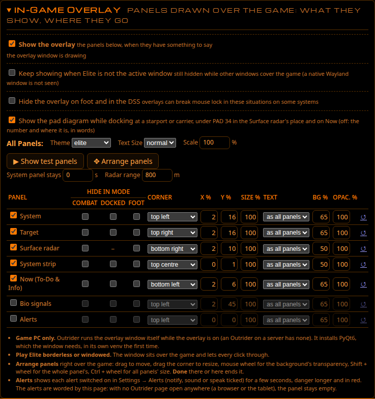
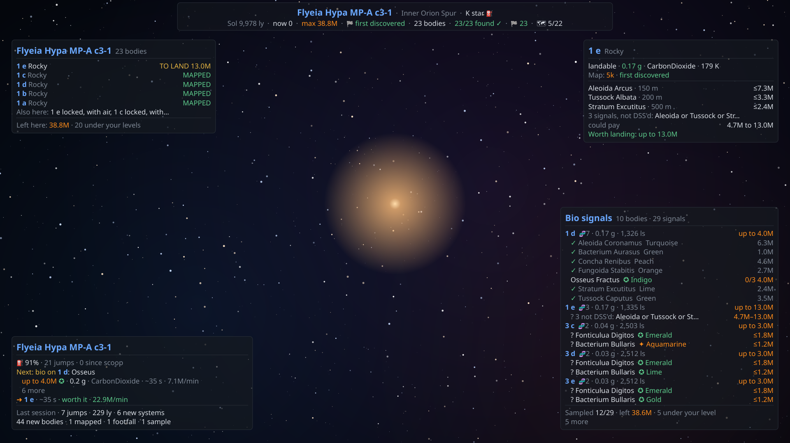
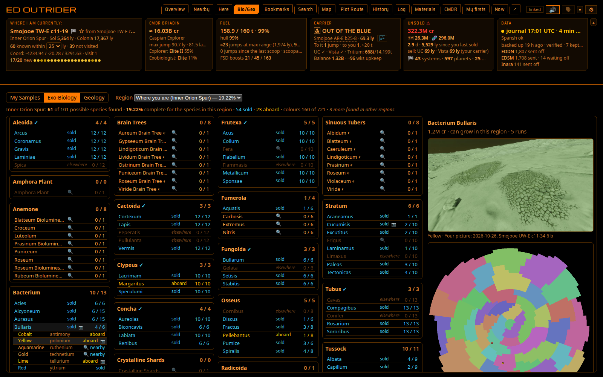
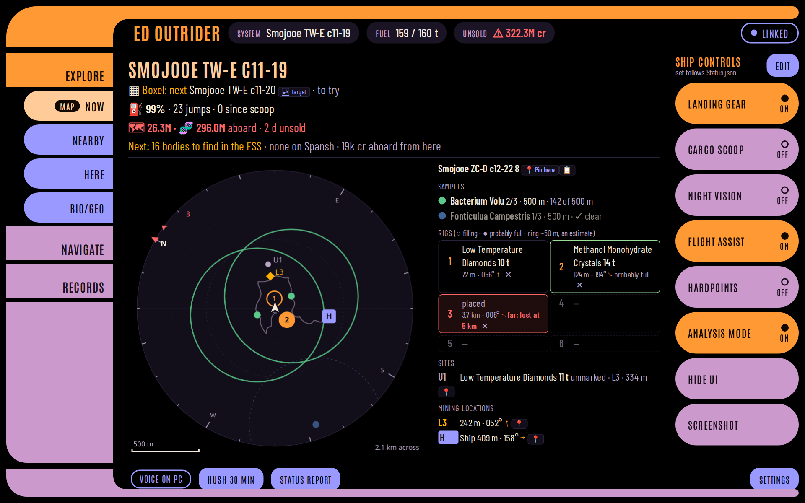

[ED Outrider](../../README.md) · **What's new** · [Install and run](install.md) · [The views](views.md) · [Plot Route](plot-route.md) · [Cargo and trading](cargo-and-trading.md) · [Voice and alerts](voice-and-alerts.md) · [Automation](automation.md) · [On a tablet](tablet.md) · [In-game overlay](overlay.md) · [Uploads](uploads.md) · [Settings and good to know](settings.md) · [For the curious](for-developers.md)

# What's new

What each release brings you, newest first: new things to try, settings worth a look, and anything that changes how
Outrider behaves. When a new release is out, a small **⬆ Update** pill appears in Outrider's header with how to get it.

> [!TIP]
> Updating from an older version? Read every section between yours and the newest: each one only lists what
> changed since the release before it.

---

## 2026.10.26 · 18 October 2026 · The Release with Personality

**Eight new personalities and over 70,000 spoken lines, a crew that talks among itself in quiet moments, other
players' chat read aloud, surface pins with fly-to guidance, carrier trips and a terraformable worlds route.**

No journal re-read: it starts as usual.

### 🎭 Eight new personalities

Down to business, sarcastic and sweet now have company. Each new one is a whole character, with its own lines for
every alert, its own way of addressing you and (all but Vulcan) a swearing version:

- **US Navy** and **Royal Navy**: by the book, crisp reports, a friendlier "Skipper" between watches. Captain or Sir.
- **Vulcan**: dry, precise, never excited, never swears, a little disappointed in its human captain.
- **Ivanova (Station Cmdr)**: temperamental, fatalistic, bored by routine exploration, eager for action, full of tall
  tales. Commander or Sir.
- **Good Ol' Boy** and **Southern Belle**: warm, playful, slow to anger, full of family sayings, the old days and
  food. Buddy and partner, or sugar and darlin'.
- **Klingon**: loud, honour-bound, exploration as the hunt. Captain, Sir, Commander or My Lord.
- **Scoundrel**: a cocky smuggler who cares about credits, calls you buddy and pal, and tells stories about the Hutton
  twins.

**Over 70,000 lines** between the eleven personalities (the last release had about 14,000): about 59,000 for the
alerts and 11,000 for the crew's chatter, clean and swearing versions. Every line was reviewed before release, and 464
that were wrong for their alert, badly worded or out of character were rewritten.

- **Main personality** sits beside **Main voice** in ⚙ Settings → Voice: one personality, or **A mix…** to tick
  several. Under it, a line says what it means: with the crew off, the main voice and personality say every alert.
- **With profanity** names the personalities that never swear ("all but Down to business, Vulcan").
- **Personalities are files** now: Outrider's own in `resources/personalities/`, yours in `data/personalities/` (a
  copy there under the same name replaces the shipped one, so an update never overwrites your changes). Settings shows
  a new file at once, with how much of the alerts it covers. See
  [Your own personality](voice-and-alerts.md#your-own-personality).

### 🎙 The crew: give each station a character

With **Split the alerts among a crew** on (⚙ Settings → Voice → Crew), each of the nine stations, the XO, Navigator,
Science Officer, Exobiologist, Chief Engineer, Quartermaster, Comms Officer, Tactical and the Mining Officer, can now
be a different personality as well as a different voice: a Klingon at Tactical, a Vulcan in Science, a Scoundrel as
Quartermaster. You know who is talking, and what about, before the sentence ends.

- The crew table is tidier: narrower Personality and Voice columns, and a **Chatter** column to leave a station out of
  the conversation (below).
- The Voice section is full width, with Main voice and personality on one line, beside the other wide sections.

### 💬 Space chatter

Off by default. Tick **Talk in quiet moments** in ⚙ Settings → Voice → Space chatter, and after a while with no
alert someone says something: in supercruise, or while you are on foot or in the SRV on a planet. See
[Space chatter](voice-and-alerts.md#-the-voice).

- **Alone:** about 60 lines per personality for supercruise (some knowing the system, your time in supercruise, the
  session's jumps and first discoveries) and 30 each for a planet, with the ship landed nearby or up in orbit.
- **With the crew on, the stations talk among themselves:** a question about another's work (fuel, the route, the
  drive, the stars, the money, mining, threats...) or, now and then, something personal (family, home, food, the best
  day, life before this ship), an answer, and sometimes a last word. Two stations that sound alike never talk to each
  other.
- **How often:** five steps, Rare, Occasional, Normal, Chatty and Non-stop, each with a few words on what it means.
- **Never at a bad moment:** not while docked, in danger, overheating, low on fuel, charging the FSD, low on oxygen or
  health on foot, with a map, the FSS or the DSS open, nor with the game closed. An alert always comes first, and
  cuts a conversation short.

### 📻 Other players' chat, read aloud

Off by default. Tick **Read aloud** on the **Chat** line in ⚙ Settings → Voice, and the **Comms Officer** reads other
players' messages to you: squadron, wing and direct messages to start, local and voice chat if you tick them, NPCs
never. See [Chat read aloud](voice-and-alerts.md#-the-voice).

- Start each with the commander's name, the name and channel ("Commander Kurbo on Squadron: …"), or nothing.
- **Paced:** one commander's messages in a row are read as one, at most one every 15 seconds, and a crowd is summed
  up ("And 3 more on Squadron"). A message that mentions you is read at once.
- **Private:** chat is never stored, cached or written to the log. 🔇 in Spoken lines mutes a commander.

### 📍 Surface pins

Named points on a body, kept until you delete them: the Anaconda wreck, Guardian ruins, a good spot to come back to.
See [Pins](views.md).

- **Add one** from the body's **📍 Pins** section in Here, by pasting or typing its coordinates (`-12.34, 45.67`,
  `Lat -12.34 Lon 45.67`...), with **📍 Pin here** where you stand, or with 📍 beside a site, a mining location or the
  ship in the surface map's legend.
- **Fly to it:** the **Navigator** guides you from orbit down: the way to turn and the distance when it is set, at
  10 km, 1 km and 100 m, and on arrival, then the next pin takes over. It shows on the surface map, the overlay's
  radar and Now.
- **Find them again:** 📍 beside a body with pins in Here and the Overview, and every pin in **Bookmarks**.

### 🚀 Carrier trips

**Plot Route → Carrier** plans your fleet carrier's trip with Spansh's carrier router: the legs, the tritium each one
burns, and where the hold has to top up the depot. It is planning only (the game still books one jump at a time), so
each leg's system is one 📋 away from the carrier's galaxy map. See [Carrier](plot-route.md).

- **The Carrier tile follows the trip:** "Leg 2/6 → the next system 📋", the cooldown counting down, then **ready**,
  and a note when the carrier is off the plan. The **Quartermaster** says when the carrier should be ready for its next
  leg.
- **A tighter Carrier tile:** tritium on one line, "Tritium: 668t/14,199t", beside UC/Vista; the meeting line reads
  "To it 1 jump · to you 1, ≈21 t".

### 🪨 A terraformable worlds route

Beside the Earth-like and ammonia routes, **Plot Route → Terraformable** chains systems with terraformable rocky and
high metal content worlds nobody has mapped yet, worth about 460 thousand credits or more mapped.

### 🛠 And more

- **The terminal's log** starts each line with the time, lines the subjects up, and words the start-up more clearly.
- **Fixes:**
  - space chatter (and the pins' guidance) could keep talking after the game was closed;
  - a species scanned twice with the composition scanner showed twice in Here's bio list;
  - a plant you tagged vanished from the surface map once you were 3 km away (thanks, Kurbo26);
  - the tablet's Map pill was hard to read in some themes (thanks, Kurbo26).

---

## 2026.10.25 · 16 October 2026 · bug fix release

**The overlay no longer breaks the game's mouse lock, fixes from a code review, and a few small improvements.**

### 🖥 The overlay

- **The mouse stays captured on foot and in the DSS** (Linux). The overlay window used to lie over the whole game, and
  then Elite could not lock the mouse: the cursor ran off onto the next monitor. Now each panel has a small window of
  its own, and there is none at all while nothing is drawn, so the middle of the screen stays Elite's. (A panel you
  drag to the middle of the screen would still be in the way.)
- **Hide the overlay on foot and in the DSS** (Settings → In-game overlay), if the mouse lock still breaks for you.
- **A Foot box for each panel** under Hide in mode: hidden on foot, in a station or on a planet's surface (say, Now).

### 🛬 Docking

- **How long before your pad is said:** Settings → Voice → **Say your landing pad … s after docking is granted**
  (0 to 20 s, 5 to start), for stations whose controllers talk longer.
- The fleet carrier diagram: pads 7 and 8 no longer poke out of the bow.

### 🔭 And more

- **Nearby in a narrow pane** (the Overview's half): it drops Jumps and Known first, and keeps the status and notable
  tags in their columns until there is really no room.
- **Settings** uses more of a big screen: 80 % of its width, in two columns (three on a 4K screen).
- **Updating a plain install** without losing your keys: the [install guide](install.md#updating) has the steps for a
  `git clone` and for a downloaded ZIP (keep `data` and `ed_outrider.toml`).
- **Fixes from a code review:**
  - after the 2026.10.24 journal re-read, ships and modules you stored could show at the wrong station until your
    next shipyard visit;
  - Nearby's Focus/Lock on your carrier kept saying "doesn't know where" after it found out;
  - CMDR → Engineering's material link now filters an open Materials tab;
  - Focus/Lock no longer shows on the Overview in Boxel mode;
  - the Nearest dialog's "shipyard" and "material trader" labels are spaced.
- The screenshots in the guide are back at 1600×1000, with the Overview also shown on a 27-inch monitor.

---

## 2026.10.24 · 15 October 2026

**Every credit you earned exploring, sampling and mining, the CMDR tab, your landing pad big and spoken (and where it
is), the game's own icons, and a smaller overlay for big screens.**

> [!IMPORTANT]
> **The first start re-reads your journals once** (each sale's station and ship, and the ore you mined, for the new
> Earnings): a few seconds, or a few minutes for years of journals. Outrider **backs up your database first**, and the
> page shows how far it has got. Your bookmarks, sample points, routes and settings are kept.

Thanks to **weidercs** for the Commander tab (pull request #5), **Rainmangames** for the ideas behind Focus/Lock
(pull request #8), **Kurbo26** for docking help, the route strip and paste (discussion #3), **javeliuswt** for the
earnings idea (discussion #7), and the report of a too-large overlay on a 4K TV.

### 💰 The CMDR tab and your earnings

- A new **CMDR** tab: who you are (credits, ranks with their progress, reputation, your ships and career), your
  **Inventory** (ships with their builds in EDSY and Coriolis, stored modules, the ship locker, suits), **Engineering**
  (blueprints against the materials you hold), **Missions** and **Sessions** (fighting and mining by login). Rest the
  mouse on a ship in Inventory for 2 seconds to see a **picture of it** (tap its name on the tablet).
- **Earnings**: what exploration, exobiology and mining paid you, all time, by year or by month, with a monthly chart.
  Every sale with where you sold it and the ship you flew, the species that paid most, your best stations, each
  ship's jumps, scans, samples and earnings, and the star classes, planet types and species you met most. **⬇ CSV**
  saves every sale.
- **Mining counts the ore you mined**, from the refinery to the sale, also when you store it on your carrier first;
  bought tons are trade and left out, and so are sales to your own carrier (your own money). A hired crew member's cut
  of your cartography is shown. Estimates (top systems by value, data lost to deaths) say they are estimates.

  

### 🛬 Docking

- **Your pad, said and shown**: "Pad 34." every time a station or carrier gives you one (by Comms, even while
  hushed, 5 seconds after the grant so it doesn't talk over the station), in very large letters on **Now** and in the overlay (in the Surface radar's place, which is free in space).
- **Where it is**, at a starport or a carrier: "at the back, up on your right", "port side, toward the bow", and a
  diagram with your pad filled in. Now and then the voice reminds you the words assume **the green lights on your
  right** as you come through the slot.
- **The tablet switches to Now** when you are given a pad, and back to your page once you have docked.
- **Quiet on auto-dock**: with a docking computer fitted, the pad is shown at once but only said if the computer has
  not taken over within 12 seconds.
- **Why a station refused**, when it isn't obvious: no pad free, ship too big, access restricted, hostile, your
  offences, a fighter still out.
- Try a pad without docking: type `!sppad 34` (a starport), `!fcpad 7` (a fleet carrier) in the game's chat, best in
  Solo. Pad layouts come from bgol's LandingPad plugin. More in [Voice and alerts](voice-and-alerts.md).

  

### 🛣 Routes

- **🛣 on the Carrier tile**: an exact route to your carrier at once, from 250 ly away; it asks before replacing a
  route you follow.
- **The In-Game Route strip**: click a chip to copy its system; **⛽** marks how far your tank goes without scooping,
  keeping 5 % of the tank in reserve (⛽✓ when it makes the whole route, ⛽ ? while Outrider learns a ship's fuel use),
  and moves as you scoop. A system targeted one jump away no longer gets a line.
- **The route line** ("🛣 Next:") now shows on **every tab**, as the target line does.
- **📋 paste**: beside Plot Route's From, To and Station, Search's Find, and the "a system…" boxes, it fills the field
  from the game PC's clipboard (for a touchscreen window that never takes focus, and the Android app).
- The route's ✦ "not reported" is only claimed where Outrider actually asked, and nothing is asked inside the bubble
  or around Colonia.

### 🔭 Nearby

- **Focus/Lock**, beside Standard / Boxel: list the systems around your destination, your carrier, your next stop,
  **this system** (locked while you fly about) or one you name; a **From you** column keeps your own distance.
- One row of filters: **Mass** (a to h), visited, fully explored, 1 jump, **no scan data**, and **⧉ Copy visible**.
- The Overview's ▾ This system fold is gone: the system pane always shows.

### 🖥 The overlay

- **Smaller for big screens**: **All Panels: Theme · Text Size · Scale** in Settings → In-game overlay, panels down to
  20 %, a **Text** column per panel, and text never drawn under 9 px; Settings shows each panel's text height. **Ctrl
  + wheel** in Arrange mode sizes them all.
- **The system strip** shows a populated system's **security** and your **reputation** with its controlling faction
  (Hostile in red).
- **Show the pad diagram while docking** turns the diagram off; the number and its words stay.

  

### 🎨 And more

- **The game's own icons**: the target button, carriers, Titans, the next stop, engineers and missions use the galaxy
  map's markers, in your theme's colours.
- Choose **which header tiles** show (Settings → Display); the Carrier tile says how many **weeks of upkeep** the
  balance covers.
- Settings → Voice → **Voice commands** lists what you can say without the AI.
- **HTTPS that works on more machines**: the system's certificates plus certifi's (kept current by the launchers once a
  week), and a plain "couldn't verify …'s certificate: check this PC's date and time" when it still fails.
- The Android app no longer offers file pickers or saves it cannot do; it says so instead.
- `launch_outrider.sh` opens each start with a header naming the version.

---

## 2026.10.23 · 14 October 2026

**The Massive Tweak Update: a crew of voices, 🎯 on every system, a Target and an Alerts panel over the game, fuel
warnings that look ahead, and a lot of small things you asked for.**

> [!IMPORTANT]
> **The first start re-reads your journals once** (to pick up your carrier's jumps and your synthesis recipes): a
> few seconds, or a few minutes for years of journals. Outrider **backs up your database first**, and the page now
> shows how far it has got. Your bookmarks, sample points, routes and settings are kept.
>
> **Without a server password, any device on your network can do whatever the page does**: change the settings (the
> password and journal folders too), restart Outrider, use your stored EDSM and Inara keys and, on the game PC, press
> keys. If other people share your network, set `[server] password` ([Other devices on your
> network](install.md#-other-devices-on-your-network)).

### 🎙 A crew of voices

Tick **Split the alerts among a crew** in ⚙ Settings → Voice → Crew and the alerts are shared among nine crew
members, so you know who is talking before the words land: the **XO** (your main voice: answers, status reports, the
co-pilot), the Navigator, Science Officer, Exobiologist, Chief Engineer, Quartermaster, Comms Officer, Tactical (every
danger line, while that switch is on) and the Mining Officer. More in [The voice](voice-and-alerts.md#-the-voice).

- Give each one a **name**, a **personality** and a **voice** (and a speaker for a several-person voice). Everyone
  starts "as the XO", so switching the crew on changes nothing until you change a row; a member whose voice is missing
  never drops a line: the XO says it.
- ⚙ Settings → Alerts gains a **Crew** column to move any alert to another member.
- **Crew lines**: with the crew on, some lines mention another member ("Fuel 18 percent. Ask the Navigator for the
  nearest scoopable star."), by name when you gave one. With the crew off you hear exactly the lines you did.
- **▶ Audition: by crew** and **▶ Audition: crew lines**, in Settings and the voice lab, which can also **Assign to a
  crew member**. "XO" is said "ex-OH" now.
- **Voices kept loaded**: Settings says how much memory your extra voices take, lets you choose how many stay loaded
  and whether to **load them at start**. Applied at once, no restart.
- **A voice per personality**: Settings → Voice → **Personality voices** gives each personality its own voice and
  speaker, for every browser and the tablet.

### 🎯 Target anything

- 🎯 now **brings the game to the front itself** and targets at once: no more 5 s countdown to click back into Elite.
  No key is pressed unless Elite's window is the active one; click away and the run stops. Where Outrider cannot see
  the game's window (no `wmctrl`, a native Wayland window) it counts down as before.
- 🎯 beside **Nearby's rows** (left of the name), **bookmarks**, the header's **next stop**, the **Nearest finder**'s
  rows and the Exo-Biology checklist's finds. A **click on the Map** targets that system. **Plot route** sits beside a
  bookmark and the next stop.
- A 🎯 shows only where it can work: on the game PC, with auto-target's keyboard and bindings in place.
- The **co-pilot button** also targets a boxel's Next, then the header's next stop. Its order is in
  [The co-pilot button](automation.md#-the-co-pilot-button).
- Ask "nearest station" (or carrier, Vista…) by voice and a place further than 500 ly gets a neutron route plotted
  (`[highway] voice_plot_ly`), unless you are following a route you have not finished.

### 🖥 The overlay

- **One Target panel** (the old body panel): the body you are near, else the body or system you target, with the
  verdict, the star's ⛽ / ✕ / ⚠ and the jump's cost. It also shows over the galaxy map.
- **An Alerts panel** (off by default): the alerts the page shows, three at most, danger ones framed in red.
- **Hide when** columns in ⚙ Settings → In-game overlay: per panel, hide it in **combat** mode and/or while
  **docked** (by default System, Target, Now and Bio hide while docked). The panel table is narrower too.
- **Keep showing when Elite is not the active window** (off by default), for a second monitor; it still hides when
  the game is minimised, on another desktop or mostly covered ([details](overlay.md#keep-showing)).
- An **overlay pill** beside the link pill: "overlay ✓", "…" or "✗" with the reason on hover.
- Here's schematic and the overlay's system panel **number the stops** ①②③ in the suggested order; tap a number on
  the schematic to make that body the first stop, "↺ order" to undo. More in the [In-game overlay](overlay.md) page.

### ⛽ Routes and fuel

- **Fuel won't reach the refuel stop**: on an exact-plotter Highway route one line says how much to scoop, "scoop to
  ≥ A t, at most B t", too little and too much from one sum.
- **Last scoopable star**: when the stars ahead on any route don't scoop and your fuel won't carry you over them,
  "⛽ last scoop before 3 dry" with how much to take, and the voice says it (its own alerts row).
- **Wrong target**: the route line says "✓ targeted", "⚠ targeted X, not the next stop Y" or "↷ 2 stops ahead"; the
  voice says a new wrong target once (its own alerts row, spoken but not notified).
- **Survey routes skip finished systems**: "Next: … · skipping 2 done", everywhere a next stop shows.
- **Earth-like** and **ammonia world** routes, and **🧹 a sweep**: tick systems in Left behind, My firsts or
  Bookmarks and plot one route through them.
- Search and the Nearest finder search **Around** another system (your destination, carrier, next stop, a name);
  **the Map draws your route** (the game's and Outrider's, dashed, ◎ on the next stop).
- Now shows the targeted jump's cost ("56.7 ly · 0.9 t · leaves 20 max jumps") and how many of your last jumps had a
  scoopable star. Find by name asks Spansh when EDSM doesn't know it.
- **"In-Game Route:"** names the game's own route line. When the game skips writing the route file (it happens), the
  line says "2 jumps left to … · the game didn't write the route's stars" instead of showing an older route; if it
  stays so, clear the route and plot a different destination. More in [Plot Route](plot-route.md).

### 🧬 Exobiology

- A sample run says what it pays **from sample 1**: "1.0M (×5: 5.0M) · sample 1/3".
- **✦ on geology** new to your codex, on Here's bodies.
- **👥 Species other commanders reported** to Spansh on a body, beside the guess.
- The guess's hover adds **your own runs** on bodies like this ("Informem 11 of 14").
- The [Exo-Biology checklist](views.md#-the-exobiology-checklist)'s **🔍 nearby** lists the nearest bodies with a
  species or colour you still need, with 🎯.
- Search → Planets: **Potential green gas giant**; or ask by voice "nearest green gas giant".
- Missing colour tables say so, with **Retry**, instead of quietly guessing without them.
- **Someone else scanned your unsold firsts**: a card, a notification and a line once in a while, "see My firsts".

### 📦 Carrier, cargo and materials

- The Carrier tile: **balance and weeks of upkeep** (amber under 4; from the community's published rates), a
  **suspended service** as its name with a red ✗, and **the trip to you** ("≈ 3 carrier jumps · ≈ 340 t tritium ·
  depot 200 t: 140 t short"). The tritium sum is checked against your carrier's own past jumps.
- **Your carrier as a place to sell**: in the nearest Universal Cartographics / Vista list while that service is on.
- **One shipload or all of it** in Sell / Buy lookups bigger than your hold; a sell order's count says how old it is.
- **Recount refuses typos** ("Did you mean: Titanium, Tritium").
- History gains a **sold** column and ✗ for a death.
- Materials: the FSD injections stay open and the other recipes fold into groups, with the ones **you have made** ✓;
  **⇄ nearest raw trader** beside a short material. The Nearest finder's Must have gains **material traders** (any,
  raw, manufactured, encoded), and the voice answers "nearest raw material trader". More in [Cargo and
  trading](cargo-and-trading.md).

### 📡 Uploads

- ⚙ Settings → Uploads shows each service's **Recent** sends and failures, what was caught up at start, and **Try
  again** on anything on hold. A **Check** button beside the EDSM and Inara keys.
- A **card and a notification** when an upload has been down for 15 minutes, and again when it is back.
- The Data tile says just **"Spansh unavailable"** (or EDSM, or "No internet connection"), with a card if it lasts.
- **Upload marks in the Log** ("✓ EDDN · ⏳ EDSM") for the last 7 days, and a "not sent" filter.
- **Fill gaps in EDSM's flight log**, and **import your EDSM flight log from before your journals** (it now rides out
  EDSM not answering instead of stopping). More in the [Uploads](uploads.md) page.

### ⚙ Server and setup

- **Show log** and **Restart** in ⚙ Settings → Server's top row; start-up problems show on a **banner** under the
  header (✕ hides it).
- **Backups** in Settings → Server, with **Back up now** and the command to restore each one; a backup is taken before
  every journal re-read ([Backups](install.md#-backups)).
- **Start with this computer**: Settings → Server, or `./launch_outrider.sh --install-service`
  ([how](install.md#start-with-your-computer)).
- The page answers while Outrider starts ("Reading your journals: March 2024, 41%").
- A first run with no journals says how to set the journal folder.
- ⚙ Settings → Auto honk says whether it **can work here** and what to fix.
- Journals on a network share cost much less work every second.

### 🗣 Voice and Settings

- **Sector names said naturally** ("SMOH-joo", "sigh-NOO-fee") for every procedural sector; the voice lab's How is it
  said box has **▶ as a sector** and your most-visited sectors.
- **Hush for a set time** by voice: "hush for ten minutes", "quiet for half an hour", "hush until the next jump".
- **New questions without AI**: "can I still make an FSD injection", "how far today", "this body", "what did I leave
  behind".
- ⚙ Settings → **Questions asked**: what the voice heard, what it matched and the answer.
- **Find a setting**: a box at the top of Settings; type a word and only the matching rows (or whole blocks and
  tables) stay.
- **Any view in its own window**: the small ↗ on a tab's corner.
- **Bookmarks → Import…**: adds a file's bookmarks to yours, keeping your own names and notes.

### 🛠 Also

- Header tiles: the jump range sits under your ship; "from X (Y ly)" beside the system's name.
- A click anywhere on a Nearby row shows that system beside the list.
- Planets sharing a centre no longer count as a 🔭 curiosity.
- The link pill says only "linked", "linked · no game" or "unlinked · retrying".
- The **Babylon 5 - Shadows** theme, for the desktop page, the tablet and the overlay.
- Many fixes from code reviews (the overlay on a workspace per monitor, the first stop, routes, uploads, the hush
  answer, the voice handed back by a view window).

### Before you update

- The first start re-reads your journals once and takes a backup first (see the note at the top).
- Nothing else to do, Docker included.

---

## 2026.10.22 · 12 October 2026

**Boxel by boxel, rare finds called out, Inara uploads, and a voice lab in the page.**

### 📦 Boxel exploration

Nearby (and the Overview's Nearby pane) has a **Standard / Boxel** switch. In Boxel mode it lists the boxel you are in
by number: the systems you visited with your scans, the ones Spansh knows with how much of each anyone reported
("known · 3 of 14 bodies", "known · honked only"), and the rest "to try". **Next** is the lowest number you have not
visited, with 🎯 to target it on the game PC (even a system nobody has visited: Outrider works out its address).

  

- Outrider cannot know how many systems a boxel holds: explore until a name the galaxy map cannot find ("probably the
  end", with a retry). **✓ complete** shows by itself; **✓ Done with this boxel** is your call.
- **📌 Keep this boxel** stays on it when you jump out; **auto-target the next on arrival** and **skip systems already
  fully scanned** are opt-in.
- **Boxels nearby** recommends the nearest boxels of each kind, with what each tends to hold and your own figures for
  it; the **Sector map** draws your sector's boxels one layer at a time. A tap explores one.
- Now and the overlay's Now panel say where the next jump goes: the route's next stop and a kept boxel's Next.

### 🌟 Rare finds, called out

- **Rare stars** (black holes, Wolf-Rayets, carbon stars, Herbig Ae/Be, supergiants, the rarer white dwarfs…),
  **notable stellar phenomena** (how many, and which you have visited), **surface sites** (Guardian, Thargoid, the new
  planetary anomaly) and **signals worth a detour** (Titans, Guardian beacons, generation ships, listening posts):
  marked on Nearby and Here, a line on Now, and each announced once, with its own switch under Discoveries.
- **Potential green gas giants**, from the community's seven-layer ladder model: a green planet with "?" on the body,
  a Now line and an alert. A guess about where to look; the system map tells.
- **✦ on star and planet types new to your codex** in this region (✪: new anywhere), on Here's bodies and Nearby's
  rows, Spansh's bodies included: a regional codex first before you scan it. Types you have scanned count as logged,
  even when your codex is older than your journals.
- Rarer planet classes (water giants, helium giants, class V) join the 🔭 curiosities, with one "you might be
  interested" line per system.

### 📡 Inara uploads

With your Inara API key in Settings → Uploads, Outrider sends what EDMC's Inara plugin sends: travel, ranks, credits,
statistics, the ship you fly and your fleet, stored modules, reputation, inventory, community goals, missions,
combat, friends and suits. Off until you switch it on; never your carrier. More in the [Uploads](uploads.md) page.

### 🎙 The voice lab, in the page

⚙ Settings → Voice → **🎙 Voice lab** replaces the separate voice_lab.py window: try any installed voice and speed,
**several-person voices** with a speaker picker (‹ › 🎲), random lines by alert and personality, an audition of key
alerts, ✂ to cut a line, your own words with **Save WAV**. **More voices** lists every Piper voice by language, sorted
by name, quality or size, with Piper's own **▶ sample** before you download.

- **How is it said**: the exobiology names are now said the usual way ("fon-TIK-yoo-loo-uh"), from a shipped table of
  120 genus and species words. A first pass: change any word your way in the box (kept in `data/pronounce.json`).
- Piper spells four star letters too ("ABCD 3").

### 🛠 Also

- 🎯 beside your carrier's system in the Carrier tile (game PC) targets it in the galaxy map.
- Here: a finished species is one line, its codex entry with what it paid, the colour's word in its colour (Settings
  → Display turns the colour off); Rings sit before ⛏; bodies not DSS'd list their possible genera more tidily.
- The Overview's surface map brings the body you are on into view; the Here heading steps aside for it.
- The Exo-Biology checklist's "aboard" counts what you carry.
- The overlay stays hidden while the game loads.
- A carrier's market that the game writes late still goes to EDDN.
- The carrier's tritium jumps no longer count a buy order's reserved space as cargo.
- The **Babylon 5 - Vorlon** theme, for the desktop page and the tablet.
- Many fixes from code reviews (auto honk waits at the menu, the launchers' paths, uploads, routes, the overlay).
- The guide is up to date, with new screenshots in the Elite theme.

### Before you update

- **The first start re-reads your journals once** (the start-up log says why): a few seconds, or a few minutes for
  years of journals. Your bookmarks, sample points, routes and settings are kept.
- Nothing else to do, Docker included. Inara stays off until you add a key.

---

## 2026.10.21 · 11 October 2026

**Panels over the game, your biology samples on EDDN, and a ✓ for every genus you finish.**

### 🖥 The in-game overlay

Outrider can now draw panels right over Elite's window, on the PC the game runs on: the bodies worth your time in the
system, the body you are heading to, a radar on a body's surface, and, when you tick them, a strip across the top
(where you are, the star, bodies found, mapped, values), **Now (To-Do & Info)** (fuel, data at risk, what to do next,
this session; hidden while docked) and **Bio signals** (every bio signal in the system, the ones worth it highlighted).
Clicks go straight through to the game.

  

- Switch it on in ⚙ Settings → **In-game overlay**, where each panel has its own row: tick it, place it from a corner
  or the middle of the top or bottom edge, size it, set its background's and its own transparency. **Arrange panels**
  lets you do the same right over the game with the mouse; **Show test panels** shows all of them for a minute.
- It needs **PyQt6** (about 100 MB): Outrider installs it into its own venv the first time, with a note at the top of
  the page while it does (the launcher does it at start when the overlay is on). On Linux it also needs `wmctrl` and
  `x11-utils` (`sudo apt install wmctrl x11-utils`); play **borderless or windowed** (not exclusive fullscreen).
- It is a game-PC feature: an Outrider in Docker or on another computer has no overlay. Windows has the code but has
  not been tried yet. More in the [In-game overlay](overlay.md) page.

  

### 🧬 A ✓ for a finished genus

In Bio/Geo → Exo-Biology, a genus gets a green **✓** once you have found every colour of every species that can grow
in that region.

  

### 📡 Uploads

- With EDDN on, your **biology samples** go to it too (the Log and Sample scans, with where on the planet you took
  each, when Outrider read it live).
- A docking at a station on a planet's surface now names that body, as EDMC does; what Outrider sends matches EDMC,
  EDDiscovery and EDDLite field for field.

### 🛠 Also

- A ship bought with **Arx** (its hull has no credit value, so its rebuy covers only the modules) no longer shows a
  "× rebuy" multiple anywhere, and the rebuy-multiple warning levels do not apply to it.
- Days since you last sold count whole days (6.7 days is "6 d", not 7).
- On Linux, `launch_outrider.sh` tells you at start which clipboard program to install for Plot Route's copy
  (wl-copy for Wayland, xclip for X11), with the command for your system.
- The exobiology colour tables are downloaded on Outrider's first start instead of shipped: a fresh install (or a new
  Docker container) needs to be online once for the colour check, as it does for everything else.
- The log's first line names the version.
- **ED Outrider is now GPL v3 or later** (it was GPL v2 or later): the overlay window adapts EDMC Modern Overlay's
  GPL v3 code.

### Before you update

Nothing to do: no journal re-read, nothing changes for Docker. To use the overlay, update on the PC the game runs on.

---

## 2026.10.20 · 10 October 2026

**Checklists for your codex, an auto-target that waits for the game, and a legend for Here's icons.**

### 🧬 Bio/Geo: what you have found, region by region

The **Samples** tab is now **Bio/Geo**, with three parts: **My Samples** (your runs, as before), and two new
checklists.

- **Exo-Biology** shows every species, one box per genus, for a galactic region (where you are, any other, or all of
  them): sold, aboard, lost or only logged, and how many of its colours you have. Click a species to drop its colours
  down; beside the boxes are its picture (Canonn's, credited to the commander who took it) and a galaxy map of where it
  can grow and where you sampled it. The region picker shows how complete each region is for you.
- **Geology** does the same for the codex's geology and anomalies (fumaroles, geysers, Lagrange clouds, the lettered
  anomalies), with how many sites other commanders have reported in the region.
- Both work on the tablet, the list and the details scrolling on their own.

  

### 🎯 Auto-target waits for the game's "danger"

The game marks you "in danger" for 16 to 26 seconds after every jump, and after entering supercruise, with nothing
around. **Target next** pressed then used to refuse again and again. Now it says *"Not targeting due to danger. I will
keep trying until you are out of danger, for up to 50 seconds"* and targets as soon as it clears. Being interdicted
still stops it.

- Charging your FSD as soon as the route is plotted no longer reports "targeting failed".
- A second press of the co-pilot button cancels a Target next that is still waiting.

### 🛣 Plot Route

- **No neutron boosts** (the exact plotter): a route of regular jumps only.
- **A system Spansh doesn't know yet** (one you just discovered) can be a route's start or end: Outrider plots from
  the nearest system Spansh knows and puts yours back in as the first or last stop. Road to Riches and Exomastery too.

### 🔣 Here

- A **legend** under the list says what each icon means, for the icons in that system only.
- The codex marks now name the colour that would be new: **✪ Cobalt**, **✦ Grey**. A Bacterium's colour comes from a
  rare element in each body's own materials, so bodies in one system can each give a different entry.
- Bodies someone else has already mapped are no longer pointed out for mapping; one line per system says so instead.

### 🛠 Also fixed

- Terraformable bodies in Spansh's data are priced as terraformable (some were priced as plain bodies). Outrider
  fetches each system's Spansh data again as you go: nothing to do.
- On the tablet's rail, hardpoints, landing gear and cargo scoop show N/A in supercruise.
- Two Outriders sharing an upload: when the sending one stops, the other carries on from exactly where it stopped.
- Bark Mounds count on the checklist; the checklist's counts and region picker; the checklist works with the keyboard.

---

## 2026.10.19.1 · 9 October 2026

**Fixes, and body names said clearly.**

### 🗣 Body names, letter by letter

With a Piper voice, a body's name is now said one letter at a time: "A 1" is *"ay one"* (it was *"uh one"*), and
"ABC 3 a" is *"ay, bee, see, three, ay"*, each letter clear. System, station and carrier names are read as before.

### 💱 Trade routes count what you trade

A commodity is ticked off once you have traded **all** of it: Plot Route shows **60 of 100 t** until then (one tonne
used to tick off the lot). If a station has less than planned, just undock: Outrider moves on to the next stop and
says what fell short, instead of the planned profit.

### 📡 Two Outriders, one upload

If the Outrider on your PC and one on a server are both switched on for EDDN or EDSM, one now sends and the other
says it is giving way (before, both stopped and nothing was sent until you switched one off).

### 🛠 Also fixed

- A Guardian FSD booster switched off no longer counts towards your jump range and fuel figures.
- The map shows your latest jumps and scans when you open it again.
- A slow, failed map request no longer replaces a newer map with "map failed".
- A market or route opened just as Outrider started still reaches EDDN when its file arrives late.
- The AI assistant stops looking things up at its round limit, and answers.

---

## 2026.10.19 · 9 October 2026

**Share what you find, and find somewhere to dock.**

> [!IMPORTANT]
> - The first start after updating **reads your journals again** (a minute or two for years of them). Nothing is lost.
> - **Docker:** Outrider now always listens on port 8025 inside the container. To use another port, set `PORT` in
>   your `.env` file, not in Settings.

### 📡 Share with EDDN and EDSM (optional, off until you switch it on)

You no longer need EDMC just to upload. In **⚙ Settings → Uploads**:

- **EDDN** sends what you discover (systems, scans, signals, codex entries, markets) to the network that Spansh,
  EDSM and Inara read, as it happens. Personal details are removed first.
- **EDSM** sends your flight log, scans and materials to your own EDSM account, in batches at each jump or docking.
  Enter your EDSM commander name and API key there (from edsm.net → Settings → API key).

  

The header's **Data** tile then shows what each sent today, and anything waiting:

  

> [!WARNING]
> **Use only one uploader.** If EDMC also uploads, or Outrider runs on both your PC and a server, everything is sent
> twice. Turn EDMC's EDDN and EDSM off first. Outrider notices EDMC on the same PC and another Outrider sharing your
> journal folder, but not EDMC on another computer. The [Uploads](uploads.md) page has the details.

If Outrider wasn't running while you played, it catches up when it starts (EDSM up to a week back, EDDN the last
hour). Nothing is ever sent from the beta, the Legacy game, or while you crew in someone else's ship.

### 📍 The nearest place to dock

**Plot Route → 📍 Nearest…** lists the closest stations and fleet carriers that have what you need: Universal
Cartographics, Vista Genomics, repair, refuel, a shipyard. It checks your pad size and how recent each report is, and
**Plot here** plots the route. Deep Space Support Array carriers are marked **🛰 DSSA**. You can also ask by voice:
*"nearest vista"*, *"nearest station with fuel"*.

  

### 🧬 For explorers

- **Tagged plants** become waypoints for your next sample.
- **✪** marks a species new to your codex anywhere in the galaxy (✦ is new in this region only).
- **"Bio possible: check the FSS"** when a body could have life nobody has reported.
- Flying low over a body shows a **bio card** with what is likely there; each genus that's ruled out says why.
- The unsold estimate counts the **full-scan bonus**, and leaves out the ×5 first-footfall bonus in populated systems,
  which never pay it.
- Star kinds, **Canonn Bioforge** links for species, and a system's bodies as a spreadsheet (**⬇ CSV** on Here).

### 🛠 Fixed, among many

- Stopping Outrider lets go of Primary Fire straight away (auto honk could hold it for up to 20 seconds).
- Auto-target closes the galaxy map it opened when it's stopped part way.
- An Apex shuttle ride no longer replaces your ship's details or its fuel figures.
- Decimal values (speech speed 1.3, say) can be saved in Server settings again.
- A password written without quotes in the config file no longer leaves the server without one.
- `launch_outrider.sh` now works on macOS.

---

## 2026.10.16 · 7 October 2026

**Cargo, your fleet carrier, and trading.**

> [!NOTE]
> The first start reads your journals again to pick up your cargo and carrier history.

### 📦 Cargo and your carrier (the Materials tab)

- Your ship's hold, with what you paid for each line.
- Your **fleet carrier's cargo**: confirmed by a sell order (✓), followed from your journal (◷) or entered by you
  (✎, **Recount…**), checked against the carrier's own total. To have a commodity counted exactly, put a sell order on
  it at a price nobody will pay. This works without signing in to Frontier, which Outrider never does.
- The **Carrier** tile shows your tritium and how many jumps it's worth.

### 💱 Trading, kept small

- **Sell / Buy** on any cargo line: where to sell all of it (or buy that much), best price or closest, with your
  profit over what you paid. Then **Plot route here**.
- **Trade routes** in Plot Route: station-to-station hops from where you're docked. Outrider tells you what to trade
  at each stop and ticks the goods off as you go.

  

### 🧭 Plot Route

- **Expressway to Exomastery**: systems with valuable life already reported, each species ticked off as you sample
  it, spoken on arrival.
- A line under the header tiles shows your route's next stop, with a **🎯** to target it in the galaxy map (on the
  game PC).

---

## 2026.10.15 · 6 October 2026

**Road to Riches.**

- **Road to Riches** (contributed by [thshurka](https://github.com/thshurka)): a chain of systems whose planets are
  worth scanning and mapping. Outrider follows it as you fly, shows what's left to do in each system, says the best
  body on arrival, and copies the next system for the galaxy map.
- The **Highway tab is now Plot Route**, with three plotters: Exact, Neutron and Road to Riches.
- Road to Riches is never auto-targeted: it's a route for stopping, not hurrying past.

  

---

## 2026.10.14 · 5 October 2026

**Know when there's an update, and a second tablet.**

- An **⬆ Update** pill appears in the header when a newer release is out, with what's new and how to update. **Skip
  this version** hides it until the next one. To turn the check off: `[server] update_check = false`.
- **A second tablet:** turn off **Show the game controls** in a tablet's Settings, and its pages take the whole width.
  One tablet can carry the controls, another just the information.
- Smaller tablets get a compact layout that fits all eight control buttons.
- **Linux:** the Highway's clipboard copy needs `wl-copy` (Wayland) or `xclip` (X11). The launcher tells you if
  neither is installed.

---

## 2026.10.13 · 5 October 2026

**Windows.**

- **`launch_outrider.bat`** sets Outrider up and starts it on Windows. Double-click it.
- Auto honk, auto-target and the tablet's control rail now work on Windows too. They are **experimental** until
  someone has tried them in game, so reports are welcome.
- A Windows path written in double quotes in the config file (`"C:\Users\..."`) can't be read. Outrider now says so
  and how to write it: `C:/Users/...`, or in single quotes.

---

## 2026.10.12 · 5 October 2026

**Themes for the browser page.**

**⚙ Settings → Display → Theme on this browser** brings the tablet's nine themes to the desktop page: LCARS, Elite,
four from Babylon 5, the Sith and the Rebel Alliance, and Dark. Or keep **Default - Outrider**. Each browser chooses
its own.

  

---

## 2026.10.11 · 4 October 2026

**The tablet speaks, and many more voices.**

- **Play alerts here:** the tablet can speak and play the alert sounds itself, with its own choice of alerts.
- The voice is **Cori** by default, and **⚙ Settings → Voice → More voices** downloads others. If the browser holds
  sound back, a **Click Here To Allow Audio** pill tells you.
- Here's schematic draws each scanned body from its scan.
- Two more tablet themes (Babylon 5's Minbari and Centauri) and emblems for several themes.
- **Settings → Server** edits the whole config file from the page. Outrider can run as a **Docker server**, you can
  **ask it questions by voice**, and an AI assistant can be added if you want one.

  

---

Every change, small ones included, is in the [changelog](../CHANGELOG.md).

[ED Outrider](../../README.md) · **What's new** · [Install and run](install.md) · [The views](views.md) · [Plot Route](plot-route.md) · [Cargo and trading](cargo-and-trading.md) · [Voice and alerts](voice-and-alerts.md) · [Automation](automation.md) · [On a tablet](tablet.md) · [In-game overlay](overlay.md) · [Uploads](uploads.md) · [Settings and good to know](settings.md) · [For the curious](for-developers.md)
